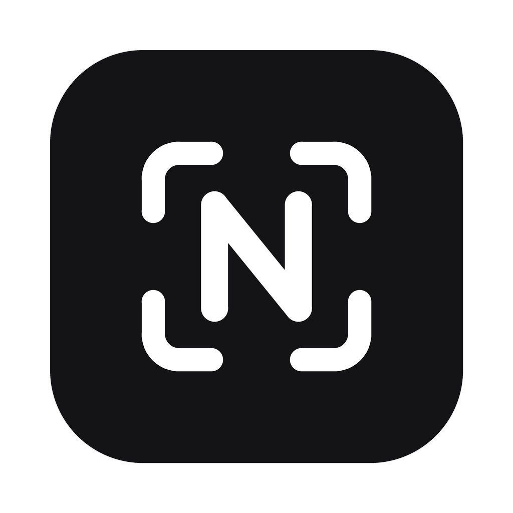

<div align="center">


# NOYA Face

**Reconnaissance faciale et protection des applications pour Mac — libre, gratuite, entièrement locale.**

*Face recognition and app protection for Mac — free, open source, fully on-device.*

[](https://github.com/elit28/Noya-FaceID/actions/workflows/ci.yml)

</div>

> [!WARNING]
> **Version 1.0.** Toutes les fonctions sont compilées et testées automatiquement sur macOS (CI) et ont fonctionné lors des essais sur un Mac. **Non mesurées** : la résistance aux photos et vidéos et la consommation.
>
> **La caméra d'un Mac n'est pas Face ID.** Elle ne mesure pas la profondeur du visage. NOYA Face apportera confort et confidentialité, mais ne remplace pas un mot de passe macOS robuste.

## Français

### Fonctions

- **Protéger des applications** (Messages, Notes, Photos…) : masquées jusqu'à votre authentification par le visage, puis Touch ID ou mot de passe vérifiés par macOS.
- **Verrouiller le Mac quand vous vous éloignez** : la caméra ne s'allume qu'après une période sans clavier ni souris.
- **Afficher les étapes autour de l'encoche**, de chaque côté (pastille sur les Mac sans encoche) — *à venir (jalon J10)*.
- **Déverrouiller l'écran** (mode avancé, désactivé par défaut) : quand votre visage est reconnu, NOYA Face **tape votre mot de passe macOS à votre place** — ce n'est pas une authentification Face ID. Mot de passe vérifié par macOS puis chiffré ; saisie automatique armée par Touch ID pour une durée limitée, désarmée à chaque redémarrage.
- **Français et anglais** dès la première version, puis espagnol, allemand, italien et portugais.

### Confidentialité

Traitement entièrement local, aucune image enregistrée, aucune donnée envoyée, aucun compte, aucune télémétrie. Détails : [`SECURITY.md`](SECURITY.md).

### Installer

1. Téléchargez **`NOYA-Face-<version>.dmg`** depuis la [dernière version](https://github.com/elit28/Noya-FaceID/releases/latest) (macOS 14 ou plus récent, Mac Apple Silicon ou Intel).
2. Ouvrez-le et glissez **NOYA Face** sur **Applications**.
3. Ouvrez NOYA Face. La première fois, macOS bloque l'app (elle n'est pas notarisée, faute de compte Apple Developer) : **Réglages Système › Confidentialité et sécurité › Ouvrir quand même**. Ne retirez jamais l'attribut de quarantaine à la main.
4. L'assistant vous guide : autorisations, puis enregistrement de votre visage.

**Mettre à jour** : Réglages › Paramètres avancés › Mises à jour (recherche désactivée par défaut). **Désinstaller** : Réglages › Paramètres avancés › Désinstaller NOYA Face.

Chaque modification du code produit aussi une app de test dans l'onglet [Actions](https://github.com/elit28/Noya-FaceID/actions) (archive « NOYA-Face-dev »).

### Compiler

Prérequis : macOS 14+, Xcode 16+.

```bash
swift build
```

```bash
swift test
```

```bash
scripts/build-app.sh
```

Plus de détails : [`CONTRIBUTING.md`](CONTRIBUTING.md) · architecture : [`docs/ARCHITECTURE.md`](docs/ARCHITECTURE.md) · audit et plan : [`docs/audit/AUDIT-TECHNIQUE.md`](docs/audit/AUDIT-TECHNIQUE.md)

## English

NOYA Face protects selected apps behind your face (with Touch ID or your macOS password as fallback, verified by macOS), locks your Mac when you walk away and, as an opt-in advanced mode, types your macOS password on the lock screen when your face is recognized (not a Face ID authentication); recognition steps around the notch are coming. Everything runs on-device: no images stored, no data sent, no account, no telemetry. **A Mac webcam is not Face ID** — NOYA Face is a convenience and privacy layer, not a replacement for a strong password. Version 1.0: download the DMG from the latest release, drag NOYA Face to Applications, then use System Settings › Privacy & Security › Open Anyway (not notarized). Every feature is built and tested automatically on macOS (CI); resistance to photos and videos and power use are not measured. Build with `swift build`, test with `swift test`, package with `scripts/build-app.sh` (macOS 14+, Xcode 16+).

## Licence — License

Code sous licence [MIT](LICENSE). Composants tiers et crédits (HeyMac, Silent-Face-Anti-Spoofing, SFace d'OpenCV Zoo) : [`THIRD_PARTY_NOTICES.md`](THIRD_PARTY_NOTICES.md). Le logo NOYA (le « N ») est une marque de NOYA 360 et n'est pas couvert par la licence MIT. NOYA Face n'est pas affilié à Apple ; « Face ID » est une marque d'Apple Inc.
