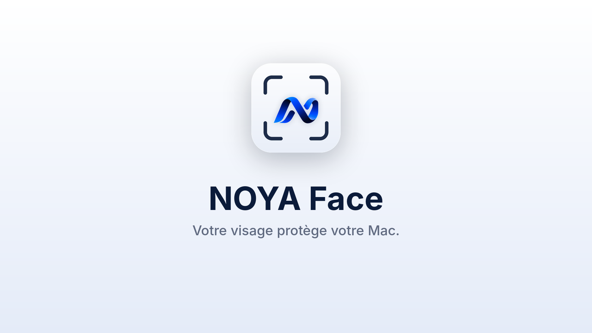
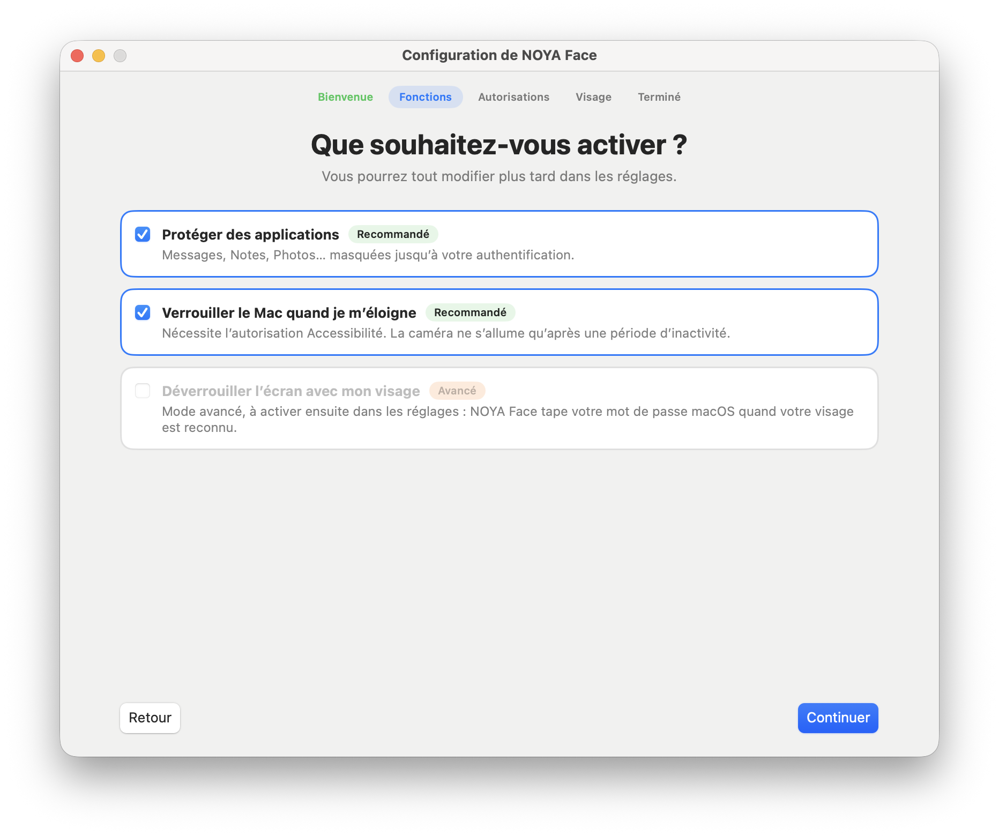

<div align="center">


# NOYA Face

**Votre visage protège votre Mac.**<br>
Protection des applications, verrouillage automatique et déverrouillage par le visage — libre, gratuit, entièrement local.

*Face recognition and app protection for Mac — free, open source, fully on-device.*

[](https://github.com/elit28/Noya-FaceID/releases/latest)
[](https://github.com/elit28/Noya-FaceID/actions/workflows/ci.yml)


[](LICENSE)

**[Télécharger](https://github.com/elit28/Noya-FaceID/releases/latest)** · [Vidéo](#vidéo) · [Fonctions](#fonctions) · [Installer](#installer) · [Sécurité](SECURITY.md) · [English](#english)

</div>

---

## Vidéo

[](docs/video/noya-face-presentation.mp4)

▶ [Regarder la présentation (30 s)](docs/video/noya-face-presentation.mp4) — montée à partir de l'icône, de l'installateur et de captures réelles de l'app. Une démonstration filmée sur Mac suivra ([script](docs/VIDEO-SCRIPT.md)).

## Fonctions

| | |
|---|---|
| **Applications protégées** | Messages, Notes, Photos… restent masquées derrière un écran opaque jusqu'à votre visage, Touch ID ou votre mot de passe (vérifiés par macOS). Reverrouillage à chaque ouverture, après 5 ou 15 min, ou à la fermeture de l'app. |
| **Verrouillage quand vous partez** | Après 1 à 10 min sans clavier ni souris, une vérification brève de votre présence ; sans votre visage, le Mac se verrouille. |
| **Déverrouillage de l'écran** | Mode avancé, désactivé par défaut : quand votre visage est reconnu, NOYA Face **tape votre mot de passe macOS à votre place**. Armé par Touch ID, désarmé à chaque redémarrage. |
| **Île de l'encoche** | Chaque étape s'affiche de part et d'autre de l'encoche (pastille sur les Mac sans encoche). |
| **Tableau de bord** | État de la protection, test de la reconnaissance, activité récente, apparences du visage (lunettes, barbe…). |
| **Propre** | Installateur DMG, mises à jour depuis l'app (désactivées par défaut), désinstallation complète. Français et anglais. |

<p align="center"></p>

## Installer

1. Téléchargez **`NOYA-Face-<version>.dmg`** depuis la [dernière version](https://github.com/elit28/Noya-FaceID/releases/latest).
2. Ouvrez-le et glissez **NOYA Face** sur **Applications**.
3. Ouvrez NOYA Face. La première fois, macOS bloque l'app, car elle n'est pas notarisée (faute de compte Apple Developer) : **Réglages Système › Confidentialité et sécurité › Ouvrir quand même**. Ne retirez jamais l'attribut de quarantaine à la main.
4. L'assistant vous guide : autorisations, puis deux tours de tête pour enregistrer votre visage.

Configuration requise : macOS 14 Sonoma ou plus récent, Mac Apple Silicon ou Intel, caméra intégrée ou externe.

**Mettre à jour** : Réglages › Paramètres avancés › Mises à jour › **Mettre à jour maintenant** — l'app télécharge la nouvelle version, la vérifie (empreinte SHA-256, identité, signature) et redémarre toute seule. **Désinstaller** : Réglages › Paramètres avancés › Désinstaller NOYA Face (supprime aussi votre visage, le mot de passe enregistré et la clé du trousseau).

## Confidentialité et sécurité

- **Tout reste sur votre Mac** : aucune image enregistrée, aucune donnée envoyée, aucun compte, aucune télémétrie. Seule la recherche de mises à jour, si vous l'activez, contacte GitHub.
- Votre visage est enregistré sous forme d'empreintes chiffrées (AES-256-GCM), clé dans le trousseau.
- **Une webcam n'est pas Face ID** : elle ne mesure pas la profondeur du visage. La résistance aux photos et aux vidéos n'a pas été mesurée ; gardez un mot de passe macOS robuste.

Détails, limites et signalement de faille : [`SECURITY.md`](SECURITY.md).

## Questions fréquentes

**Est-ce Face ID ?** Non. Face ID utilise une caméra 3D ; un Mac n'a qu'une caméra 2D. NOYA Face apporte confort et confidentialité, pas le niveau de sécurité de Face ID.

**Pourquoi « Ouvrir quand même » ?** Apple n'autorise l'ouverture directe que des apps notarisées, ce qui exige un compte Apple Developer payant. Le code est public : vous pouvez le vérifier ou le compiler vous-même.

**Le déverrouillage ne se lance pas ?** Sur l'écran verrouillé, bougez la souris, touchez le trackpad ou appuyez sur Maj : la recherche démarre, avec 2 essais. Vérifiez aussi que la saisie automatique est armée (menu NOYA Face › « Armer le déverrouillage de l'écran… ») et que l'autorisation Accessibilité est accordée (Réglages › Diagnostic), car macOS peut la retirer après une mise à jour.

**Le Mac se déverrouille-t-il après un redémarrage ?** Non : le mot de passe reste obligatoire après un redémarrage, pour FileVault et au changement d'utilisateur.

**Pourquoi l'île n'apparaît-elle pas sur l'écran verrouillé ?** Il faudrait des API privées de macOS, que le projet refuse d'utiliser.

## Compiler depuis les sources

Prérequis : macOS 14+, Xcode 16+ (Swift 6).

```bash
swift build
```

```bash
swift test
```

```bash
scripts/build-app.sh
```

```bash
scripts/build-dmg.sh dist/NOYA-Face.dmg
```

## Structure du dépôt

```
Sources/
  NoyaCore/     reconnaissance (SFace), présence réelle (MiniFASNet), stockage chiffré
  NoyaEngine/   caméra, enrôlement, vérification, armement, mises à jour (logique testée)
  NoyaFace/     l'app : assistant, réglages, apps protégées, absence, déverrouillage, île
Tests/          tests Swift Testing (cœur et moteur)
packaging/      Info.plist, traductions fr/en, icône, logo, fenêtre d'installation (DMG)
scripts/        construction de l'app et du DMG, contrôles du dépôt, génération des visuels
docs/           architecture, audit, protocoles de test, notes de version, vidéo
```

Plus de détails : [architecture](docs/ARCHITECTURE.md) · [audit technique](docs/audit/AUDIT-TECHNIQUE.md) · [contribuer](CONTRIBUTING.md) · [journal des versions](CHANGELOG.md).

## Licence et crédits

Code sous licence [MIT](LICENSE). Composants tiers : HeyMac (MIT), Silent-Face-Anti-Spoofing (Apache-2.0), SFace d'OpenCV Zoo (Apache-2.0) — voir [`THIRD_PARTY_NOTICES.md`](THIRD_PARTY_NOTICES.md). Le logo NOYA (le « N ») est une marque de [NOYA 360](https://noya360.fr) et n'est pas couvert par la licence MIT. NOYA Face n'est pas affilié à Apple ; « Face ID » est une marque d'Apple Inc.

---

## English

**NOYA Face** protects selected apps behind your face (Touch ID or your macOS password as fallback, verified by macOS), locks your Mac when you walk away and, as an opt-in advanced mode, types your macOS password on the lock screen when your face is recognized — this is not a Face ID authentication. Recognition steps appear around the notch; a dashboard, update check (off by default) and full uninstall are included. Everything runs on-device: no images stored, no data sent, no account, no telemetry.

**Install:** download the DMG from the [latest release](https://github.com/elit28/Noya-FaceID/releases/latest), drag NOYA Face to Applications, then use System Settings › Privacy & Security › **Open Anyway** (the app is not notarized). Requires macOS 14 or later, Apple Silicon or Intel.

**Know before you use it:** a webcam is not Face ID; resistance to photos and videos has not been measured. Keep a strong macOS password. Build with `swift build`, test with `swift test`, package with `scripts/build-app.sh` and `scripts/build-dmg.sh`. MIT license; the NOYA logo is a trademark of NOYA 360.
