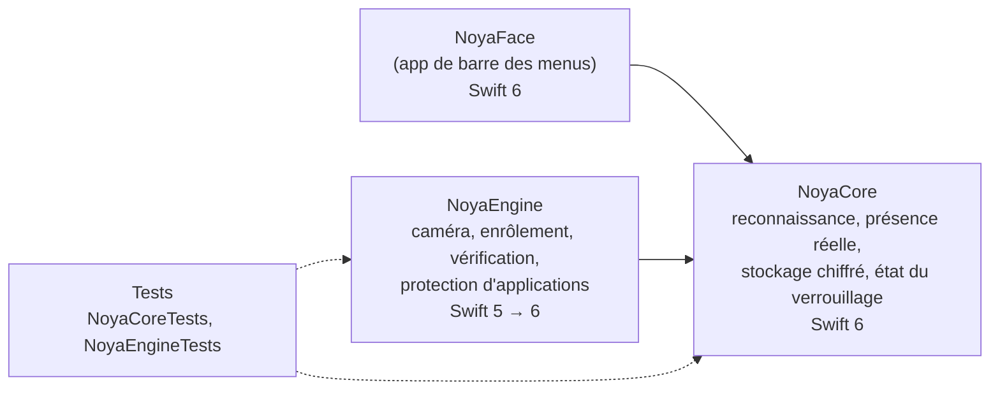
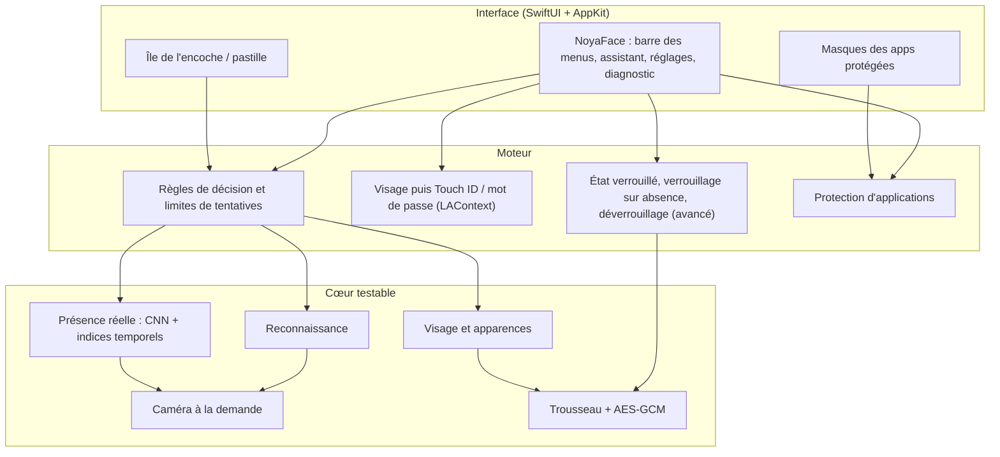

# Architecture de NOYA Face

Document de référence de l'architecture. Les choix et leur justification figurent dans [`audit/AUDIT-TECHNIQUE.md`](audit/AUDIT-TECHNIQUE.md).

## État actuel — socle (jalon J1)

| Module | Rôle | Origine |
|---|---|---|
| `NoyaCore` | Détection (Vision), alignement 5 points, extracteur d'empreinte (modèle ajouté au jalon J2), classifieur anti-usurpation MiniFASNet, stockage AES-GCM, lecture de l'état de verrouillage | HeyMac (MIT), adapté |
| `NoyaEngine` | Capture caméra à la demande, enrôlement, fenêtres de vérification bornées, coordination visage → Touch ID / mot de passe, sessions de confiance des apps protégées | HeyMac (MIT), adapté |
| `NoyaFace` | Application : icône de barre des menus (masquable), fenêtre de réglages, état réel des composants | Nouveau |

L'app n'utilise pas encore le moteur : aucune fonction de protection n'est active au jalon J1.

## Cible

## Construction et contrôles

| Étape | Outil |
|---|---|
| Compilation, tests | `swift build`, `swift test` (Swift Testing) |
| App | `scripts/build-app.sh` : assemblage, traductions, icône, signature ad hoc ou identité locale, Hardened Runtime |
| Vérification de l'app | `scripts/verify-app.sh` : signature, runtime, entitlement caméra seul, identifiant, ressources, traductions, absence de modèle InsightFace |
| Contrôles du dépôt | `scripts/check-private-api.sh`, `scripts/check-localizations.py`, `scripts/check-repository.sh` |
| Intégration continue | `.github/workflows/ci.yml` : contrôles (Linux) puis compilation, tests et app (macOS) ; l'app de test est publiée en archive |

## Localisation

Textes de l'interface écrits en français dans le code (clés) ; traductions dans `packaging/<langue>.lproj/Localizable.strings` et `InfoPlist.strings`, copiées dans le bundle de l'app. Langue de développement : français ; langues : français, anglais (puis espagnol, allemand, italien, portugais). Le contrôle CI refuse tout texte non traduit.

Format retenu : fichiers `.strings` (système de localisation d'Apple, compatible avec la compilation en ligne de commande de SwiftPM, comme dans HeyMac). Un passage au catalogue `.xcstrings` est possible si le projet adopte un projet Xcode.
