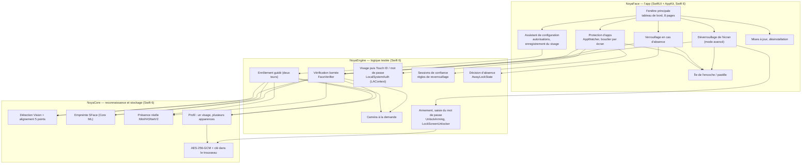

# Architecture de NOYA Face

Document de référence de l'architecture. Les choix et leur justification figurent dans [`audit/AUDIT-TECHNIQUE.md`](audit/AUDIT-TECHNIQUE.md).

## Vue d'ensemble — version 1.0

| Module | Rôle | Origine |
|---|---|---|
| `NoyaCore` | Détection (Vision, tous les visages), alignement 5 points, empreinte SFace (Core ML), profil « un visage, plusieurs apparences », classifieur anti-usurpation MiniFASNetV2, stockage AES-GCM, état du verrouillage | HeyMac (MIT), adapté ; SFace (Apache-2.0) |
| `NoyaEngine` | Caméra à la demande, enrôlement guidé, vérification bornée, visage → Touch ID / mot de passe, sessions des apps protégées, décision d'absence, armement et saisie du mot de passe, vérification du mot de passe (OpenDirectory), comparaison de versions | HeyMac (MIT), adapté et complété |
| `NoyaFace` | L'app : barre des menus, assistant, fenêtre principale, bouclier des apps, verrouillage en cas d'absence, déverrouillage de l'écran, île de l'encoche, mises à jour, désinstallation | Nouveau ; bouclier et observateur d'apps adaptés de HeyMac |

Principes : API publiques uniquement (contrôle CI), caméra jamais allumée sans action ou délai d'inactivité, aucune image enregistrée, mot de passe déchiffré seulement après une reconnaissance positive.

## Construction et contrôles

| Étape | Outil |
|---|---|
| Compilation, tests | `swift build`, `swift test` (Swift Testing) |
| App | `scripts/build-app.sh` : assemblage, traductions, icône, signature ad hoc ou identité locale, Hardened Runtime |
| Vérification de l'app | `scripts/verify-app.sh` : signature, runtime, entitlement caméra seul, identifiant, ressources, traductions, absence de modèle InsightFace |
| Contrôles du dépôt | `scripts/check-private-api.sh`, `scripts/check-localizations.py`, `scripts/check-repository.sh` |
| Image disque | `scripts/build-dmg.sh` : fenêtre d'installation à la marque (dmgbuild, sans AppleScript), vérifiée par `hdiutil verify` |
| Intégration continue | `.github/workflows/ci.yml` : contrôles (Linux) puis compilation, tests, app et DMG (macOS) ; l'app de test est publiée en archive |
| Publication | `.github/workflows/release.yml` (lancement manuel) : mêmes étapes, puis version GitHub avec DMG, ZIP et empreintes SHA-256 |
| Visuels | `scripts/generate-app-icon.py` (icône), `scripts/generate-dmg-background.py` (installateur), `scripts/make-presentation-video.py` (vidéo) |

## Localisation

Textes de l'interface écrits en français dans le code (clés) ; traductions dans `packaging/<langue>.lproj/Localizable.strings` et `InfoPlist.strings`, copiées dans le bundle de l'app. Langue de développement : français ; langues : français, anglais (puis espagnol, allemand, italien, portugais). Le contrôle CI refuse tout texte non traduit.

Format retenu : fichiers `.strings` (système de localisation d'Apple, compatible avec la compilation en ligne de commande de SwiftPM, comme dans HeyMac). Un passage au catalogue `.xcstrings` est possible si le projet adopte un projet Xcode.
