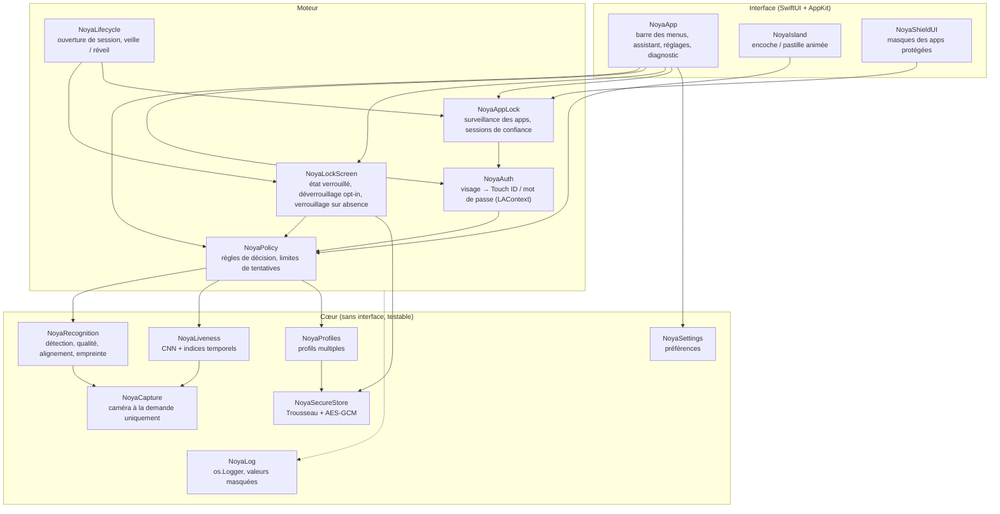
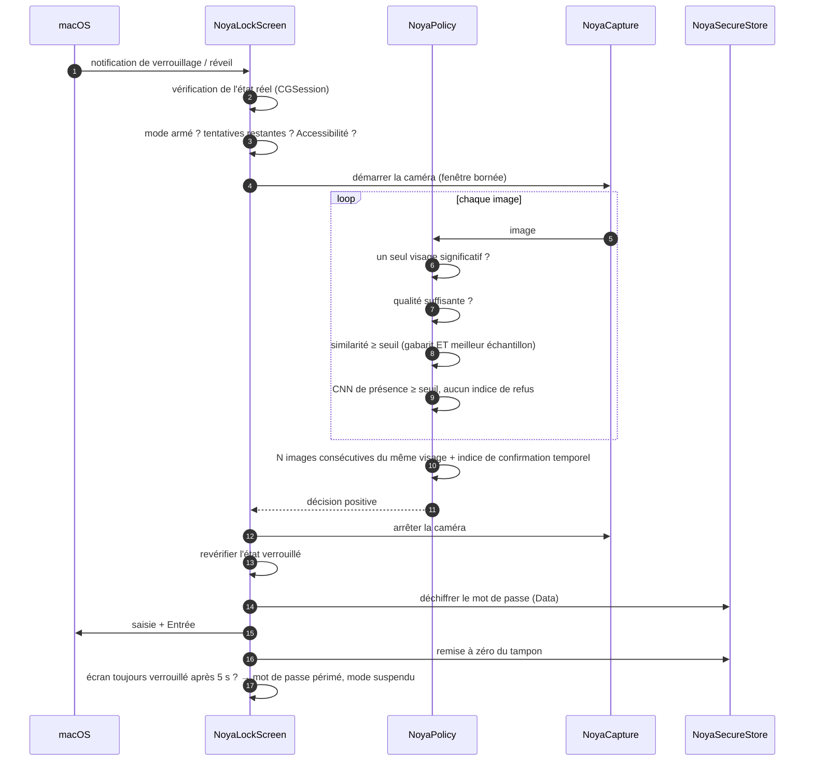
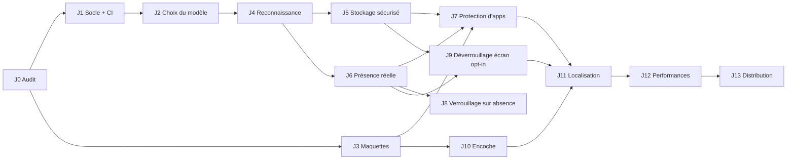

# Audit technique — NOYA Face

> Phase 1 (audit) et phase 2 (architecture) — document de décision, **aucun code applicatif n'a encore été écrit**.
>
> - Date : 16 novembre 2026
> - Dépôts analysés (clonés en lecture seule) :
>   - [iharshitmaurya/HeyMac](https://github.com/iharshitmaurya/HeyMac) — commit `a73667d` (09/11/2026)
>   - [jonnyoo/glance](https://github.com/jonnyoo/glance) — commit `b97f521` (29/09/2026)
>   - [HasBrain/FaceUnlock](https://github.com/HasBrain/FaceUnlock) — commit `d1a62e5` (19/07/2026)
> - Méthode : lecture du code source. Les références `fichier:ligne` renvoient au commit indiqué.
> - **Limites de cet audit** : l'environnement d'analyse est Linux, sans Xcode ni Mac. **Rien n'a été compilé, exécuté ni mesuré.** Aucun chiffre de performance ou de taux de reconnaissance n'est donné : ils devront être mesurés sur le MacBook Air M5 (jalons J4 à J11).

---

## 0. Synthèse

| Question | Réponse |
|---|---|
| Meilleure base | **HeyMac** (architecture modulaire, 110 tests, protection d'applications, licence MIT, maintenu activement) |
| À porter depuis Glance | Détection de présence réelle multi-indices temporels, profils faciaux multiples, clé de session protégée par Touch ID au niveau du Trousseau, détection du verrouillage par événements (sans scrutation) |
| À reprendre de FaceUnlock | **Aucun code.** Uniquement trois idées : rejet des images de préchauffage caméra, filtre de pose, moyenne glissante des empreintes |
| Bloquant n° 1 | **Licence du modèle de reconnaissance** : les trois projets embarquent un modèle ArcFace d'InsightFace, licencié « recherche non commerciale uniquement » ; depuis le 24/11/2025 InsightFace demande de le contacter pour toute licence des paquets `buffalo_*`. Incompatible avec une redistribution MIT sans réserve. |
| Bloquant n° 2 | **Il n'existe aucune API publique permettant à une application tierce de déverrouiller la session macOS.** Les trois projets **tapent le mot de passe stocké** dans l'écran de verrouillage par frappes simulées. Ce n'est pas une authentification ; c'est une saisie automatique. |
| Bloquant n° 3 | **Compte Apple Developer (99 $/an)** nécessaire pour : notarisation, identité de signature stable (sinon les autorisations Caméra/Accessibilité sont perdues à chaque mise à jour), et très probablement pour le Trousseau à protection biométrique (à confirmer, voir §3). |
| Sécurité réelle | Une webcam 2D ne vaut pas Face ID. Aucun des trois projets ne résiste de façon démontrée à une **vidéo rejouée**. Glance l'écrit explicitement (`FaceUnlockCoordinator.swift:7`). |

---

## 1. Tableau comparatif technique

| Critère | HeyMac | Glance | FaceUnlock |
|---|---|---|---|
| Activité | 130 commits, 12/09 → 09/11/2026 | 133 commits, 21/07 → 29/09/2026 | 23 commits, 05/07 → 19/07/2026 |
| Licence du code | MIT | MIT | MIT |
| Contributions externes | Acceptées (PR numérotées) | « Not currently accepting PRs » (README) | Non précisé |
| Structure | Swift Package, 3 modules : `HeyMacCore` (reconnaissance, crypto), `HeyMacEngine` (moteur), `HeyMacApp` (UI) | Projet Xcode, une seule cible, 1 dossier plat | Projet Xcode, une cible ; `ContentView.swift` 1 250 lignes, `AppController.swift` 822 lignes |
| Volume Swift (sources) | ~7 300 lignes | ~14 100 lignes | ~4 000 lignes |
| macOS minimum (README) | 14 | 15 | 14 |
| Tests automatisés | **110 tests** Swift Testing (Core 42, Engine 48, App 20), logique pure + chargement des modèles ; rien sur les taux de fausse acceptation | **0** test unitaire (2 scripts manuels, dont `tools/liveness_selftest.swift`) | **0** |
| CI | Aucune | Aucune | Aucune |
| Langage / concurrence | `swift-tools-version:6.0`, mais mode Swift 6 sur Core seulement ; Engine et App en `.v5` (`Package.swift:24-50`), 13 classes `@unchecked Sendable` | Swift 5 + isolation `MainActor` par défaut | Swift 5 + `MainActor` ; cible macOS 26.5 alors que le README annonce 14 |
| Signature | Identité auto-signée ou ad hoc, **sans Hardened Runtime**, non notarisée (`scripts/lib-signing.sh:16-30`) | Équipe Apple, Hardened Runtime, entitlements caméra + trousseau ; notarisation non vérifiable | Ad hoc, Hardened Runtime, entitlements vides |
| Contournement Gatekeeper demandé | « Ouvrir quand même » | Aucun | `xattr -dr com.apple.quarantine` |
| Mise à jour automatique | Sparkle 2.10.0 (EdDSA, appcast GitHub) | Sparkle 2.9.6 (EdDSA, site propre) | Aucune |
| Démarrage / arrière-plan | Login item + LaunchAgent `KeepAlive` ; scrutation 250 ms permanente | Login item ; événementiel | Ajout manuel aux éléments d'ouverture ; événementiel |
| Détection de visage | Vision `VNDetectFaceLandmarksRequest` | Vision rectangles + landmarks + qualité de capture | Vision |
| Modèle d'identité | ArcFace `w600k_mbf` (MobileFaceNet, 6,8 Mo) — **mêmes poids que Glance** (SHA-256 identique) | ArcFace `w600k_mbf` (6,8 Mo), repli `VNGenerateImageFeaturePrint` | ArcFace `w600k_r50` (ResNet50, 87 Mo) |
| Licence des poids | InsightFace : non commercial | InsightFace : non commercial | InsightFace : non commercial (déclaré dans le README) |
| Profils faciaux | 1 seul (centroïde unique) | Plusieurs identités, activables séparément | 1 jeu d'empreintes (max 35) |
| Images stockées | Non (centroïde chiffré) | Non (empreintes chiffrées) | Non (empreintes chiffrées) |
| Présence réelle | Réseau MiniFASNetV2 (Silent-Face-Anti-Spoofing, Apache-2.0), image par image, 2 images consécutives | 5 indices sur ~2 s : reflets, cadre d'appareil (refus) ; parallaxe nez/lacet, géométrie 3D, clignement (confirmation). **Mode « Léger » par défaut = refus seulement** | Variation de lacet ou de roulis > 0,013 rad (≈ 0,75°) sur 6 images |
| Plusieurs personnes | Choisit le plus grand visage | Choisit le visage dominant / continuité | Choisit un visage centré |
| Seuil de similarité par défaut | 0,50 (0,45 « Relaxed », 0,60 « Strict ») | 0,66 | 0,70 |
| Stockage du mot de passe | Fichier AES-GCM ; clé dans le trousseau de session **sans contrôle d'accès** | Trousseau, AES-GCM ; clé de session protégée `.userPresence` (Touch ID/mot de passe) | Trousseau, AES-GCM ; clé **sans contrôle d'accès**, Touch ID vérifié seulement par l'application |
| Durée de vie de la clé en mémoire | Toute la vie du processus | Jusqu'à 30 jours par défaut (7 j minimum) | Toute la vie du processus |
| Déverrouillage | Frappes simulées `CGEvent` (`.cghidEventTap`) + Accessibilité | Idem + effacement préalable du champ | Idem |
| Détection du verrouillage | Scrutation toutes les 250 ms + `dlopen` à chaque tour | Notifications + vérification `CGSessionCopyCurrentDictionary` | Notifications + vérification `CGSessionCopyCurrentDictionary` |
| Affichage sur l'écran verrouillé | **API privées SkyLight** | **API privées SkyLight** | Aucun |
| Protection d'applications | **Oui** (bouclier, Touch ID/mot de passe système, politiques de reverrouillage) | Non | Non |
| Verrouillage automatique en cas d'absence | Non | Non | Non |
| Localisation | Fondation en place (anglais) | Chaînes en dur (anglais) | Chaînes en dur (anglais) |
| Anti-débogage | Non | Non | `ptrace(PT_DENY_ATTACH)` via `dlsym` |

Détails : build et distribution au §7, interface et protection d'applications au §8.

---

## 2. Analyse du module le plus sensible : le déverrouillage

### 2.1 Ce que font réellement les trois projets

Les trois projets suivent le même schéma : le mot de passe de session est stocké chiffré, puis, quand un visage correspond, il est **tapé** dans le champ de l'écran de verrouillage par des événements clavier synthétiques.

- HeyMac : `Sources/HeyMacEngine/KeystrokeInjector.swift:255-286` — un événement Unicode par caractère, posté sur `.cghidEventTap`, puis Entrée.
- Glance : `glance/KeystrokeInjector.swift:42-161` — efface d'abord le champ (⌘→ puis ⌘⌫), envoie le texte par lots de 20 unités UTF-16 sans couper les paires de substitution, puis Entrée.
- FaceUnlock : `FaceUnlock/Security/KeystrokeInjector.swift:46-89` — un événement par caractère.

Conséquences :

1. **Ce n'est pas une authentification.** macOS reçoit le vrai mot de passe ; la reconnaissance faciale ne fait que décider s'il faut le taper. La sécurité globale est donc *au mieux* celle du mot de passe, et *en pratique* celle du maillon le plus faible entre la reconnaissance faciale et le stockage du mot de passe.
2. **Comportement non garanti par Apple.** L'API `CGEvent` est publique, mais son acheminement jusqu'au champ sécurisé de l'écran de verrouillage n'est pas documenté. Une mise à jour de macOS peut le bloquer sans préavis.
3. **Accessibilité obligatoire** : c'est une permission très large (contrôle de toute l'interface).

### 2.2 Stockage du mot de passe — comparaison détaillée

**HeyMac**
- Clé AES-256 stockée comme mot de passe générique dans le trousseau de session, sans `kSecAttrAccessControl` ni `kSecAttrAccessible` (`Sources/HeyMacCore/Security/KeychainKeyProvider.swift:68-77`). Seule la liste de contrôle d'accès par application du trousseau historique la protège.
- La clé est mise en cache pour toute la durée du processus (`CachingKeyProvider.swift:24-31`).
- Fichiers chiffrés AES-GCM écrits en `0600` par renommage atomique, dossier en `0700` (`SecureStore.swift:139-169`) — **bonne pratique, réutilisable**.
- **Défaut** : le mot de passe est déchiffré **avant** la reconnaissance faciale et conservé dans une `String` Swift (non effaçable) pendant toute la fenêtre de scan de 6 s (`LockScreenUnlocker.swift:141-153`).
- **Qualité** : si l'écran reste verrouillé 5 s après la saisie, le mot de passe est considéré comme périmé et la saisie automatique est désactivée (`LockScreenUnlocker.swift:185-196`) — évite de verrouiller le compte par tentatives répétées.

**Glance**
- Deux niveaux : une clé de session protégée par `SecAccessControl` `.userPresence` + `WhenUnlockedThisDeviceOnly` (`KeychainManager.swift:338-350`), qui chiffre un blob de mot de passe stocké sans protection biométrique (`SecureCredentialManager.swift:5-6, 171-186`).
- Touch ID est demandé une fois, puis la clé reste en mémoire jusqu'à un délai d'inactivité : **30 jours par défaut**, choix 7/14/30 jours ou jamais (`Settings/GlanceSettings.swift:13-34, 340-342`, `SessionAutoLocker.swift:16-17`).
- Le mot de passe est manipulé en `Data` et remis à zéro après usage (`POCController.swift:112-116`) ; une conversion en `String` reste nécessaire juste avant la saisie (`KeystrokeInjector.swift:46`).
- Refuse de créer une nouvelle clé si des données chiffrées existent déjà (`SecureCredentialManager.swift:138-142`) — **bonne pratique**.
- Entitlement `keychain-access-groups` avec `$(AppIdentifierPrefix)` (`glance/glance.entitlements`) : suppose une signature avec un identifiant d'équipe Apple.

**FaceUnlock**
- La protection `.userPresence` a été **retirée** « pour compatibilité avec la signature ad hoc » (`Security/PasswordVault.swift:5-13`). La clé de session et le blob chiffré sont tous deux dans le trousseau **sans contrôle d'accès** (`PasswordVault.swift:324-330, 345-351`).
- Touch ID est vérifié par l'application (`LAContext.evaluatePolicy`) avant une lecture qui, elle, n'exige rien (`PasswordVault.swift:210-254`). **La « protection Touch ID » annoncée par le README n'est pas appliquée par le système** : tout code capable de lire ces éléments du trousseau obtient la clé et le mot de passe.
- Politique `.deviceOwnerAuthenticationWithBiometrics` (`PasswordVault.swift:217`) : échoue sur un Mac sans Touch ID, contrairement au README qui annonce « Touch ID or a device password ».
- Attente bloquante sur sémaphore autour de `evaluatePolicy` (`PasswordVault.swift:221-227`), motif que Glance documente comme source d'interblocage (`SecureCredentialManager.swift:121-122`).

> Enseignement clé (à confirmer sur Mac) : la protection biométrique d'un élément du trousseau semble exiger le **trousseau à protection des données** et donc une signature avec identifiant d'équipe. Indice concret : FaceUnlock a dû la retirer en signature ad hoc ; Glance la conserve avec un entitlement d'équipe. La note technique Apple TN3137 traite de ce sujet ; elle n'a pas pu être relue ici et devra être vérifiée.

### 2.3 Détection fiable de l'état « verrouillé »

- Notifications distribuées `com.apple.screenIsLocked` / `screenIsUnlocked` : non documentées et **falsifiables par tout processus de l'utilisateur** (Glance le note : `LockMonitor.swift:187-188`).
- `CGSessionCopyCurrentDictionary()` : Glance et FaceUnlock l'appellent directement (`LockMonitor.swift:289`, `FaceUnlock/Security/LockMonitor.swift:162`), ce qui montre que la fonction est déclarée dans le SDK. **La clé `CGSSessionScreenIsLocked` lue dans le dictionnaire n'est pas documentée.** HeyMac la résout par `dlopen`/`dlsym` en la qualifiant de privée (`LockStateMonitor.swift:3-33`), et ce, **à chaque tour de boucle de 250 ms** (`LockScreenUnlocker.swift:105-109, 122`).
- Les trois revérifient l'état juste avant la saisie. HeyMac le fait avant **et** après le réveil de l'écran (`ScreensaverWatcher.swift:64-86`) — à conserver.

### 2.4 Ce que macOS permet, officiellement ou non

| Besoin | Mécanisme | Statut |
|---|---|---|
| Déverrouiller une session ouverte (écran de verrouillage, réveil de veille) | Saisie simulée du mot de passe via `CGEvent` + Accessibilité | **Contournement** : API publique utilisée hors de son objet, comportement non documenté |
| Idem, sans stocker le mot de passe | *Authorization Plugin* (Authorization Services, `/Library/Security/SecurityAgentPlugins`) | Mécanisme documenté par Apple, utilisé par des outils d'entreprise. Exige une installation **root**, la modification de la base d'autorisations et comporte un **risque de blocage de session**. **Non vérifié** pour le déverrouillage sans mot de passe sur macOS 26 → piste de recherche, prototype en machine virtuelle uniquement, **hors v1** |
| Écran de connexion après redémarrage | — | **Impossible** : le trousseau de session exige le mot de passe. Même comportement que Touch ID sur Mac |
| Déverrouillage FileVault au démarrage | — | **Impossible** : aucun code tiers ne s'exécute avant l'authentification FileVault |
| Changement rapide d'utilisateur | — | **Non pris en charge** : mot de passe obligatoire |
| Touch ID / mot de passe dans l'application | `LAContext.evaluatePolicy(.deviceOwnerAuthentication)` | **Officiel** — utilisable pour la protection d'applications et pour « armer » la session, pas pour l'écran de verrouillage |
| Vérifier que le mot de passe saisi par l'utilisateur est correct avant de le stocker | OpenDirectory `ODRecord.verifyPassword` | API publique (aucun des trois ne l'utilise) — **à valider** sur Mac |
| Afficher une interface au-dessus de l'écran verrouillé | SkyLight `SLSSpaceCreate`, `SLSSpaceSetAbsoluteLevel`, `SLSShowSpaces`… via `dlopen` (HeyMac `Island/LockScreenSpace.swift:39-52`, Glance `NotchOverlay/NotchSkyLight.swift:34-51`) | **API privée** — peut casser à chaque mise à jour |
| Empêcher réellement l'ouverture d'une application | Endpoint Security (`AUTH_EXEC`) | Exige un entitlement accordé par Apple et une extension système : **hors de portée** d'un projet open source compilable par tous. Les trois projets n'en utilisent pas |
| Verrouiller le Mac en cas d'absence | Raccourci système ⌃⌘Q simulé (Accessibilité) ou mise en veille de l'écran si « Exiger le mot de passe immédiatement » | Aucun des trois ne l'implémente — **à valider** sur Mac |

---

## 3. Reconnaissance faciale et présence réelle

### 3.1 Reconnaissance

- **HeyMac** : alignement 5 points sur le gabarit ArcFace avec un échantillonneur bilinéaire équivalent à OpenCV (`FaceGeometry.swift`), empreinte normalisée, comparaison cosinus avec **un seul centroïde** (`VerificationPipeline.swift:189-221`). Deux images consécutives acceptées exigées, arrêt après 6 images « mauvais visage » (`FaceVerifier.swift:90-122`). Seuils 0,45/0,50/0,60 (`EngineSettings.swift:6-11`) — nettement plus permissifs que Glance (0,66) **pour le même modèle** : à calibrer par mesure.
- **Glance** : plusieurs identités, chacune avec ses échantillons et un gabarit ; un visage doit dépasser le seuil sur le gabarit **et** sur le meilleur échantillon (`FaceRecognitionPipeline.swift:126-147`) ; identités marquées « périmées » si l'extracteur change. Repli silencieux vers `VNGenerateImageFeaturePrint` si ArcFace ne se charge pas (`FaceRecognitionPipeline.swift:44-52`) — à proscrire dans NOYA Face (échec franc préférable).
- **FaceUnlock** : moyenne glissante de 15 empreintes, rejet des images des 800 premières ms (exposition caméra non stabilisée), filtre de pose (`AppController.swift:686-800`). Idées intéressantes ; modèle ResNet50 13 fois plus lourd.

**Plusieurs personnes dans le champ** : aucun des trois ne refuse. HeyMac prend le plus grand visage (`FaceGeometry.swift:198`), Glance le visage dominant (`FaceRecognitionPipeline.swift:99-112`). Pour un déverrouillage, NOYA Face devra **refuser** lorsqu'un second visage significatif est présent (réglable pour la protection d'applications).

### 3.2 Présence réelle (anti-usurpation)

| Attaque | HeyMac (CNN image par image) | Glance mode Léger (défaut) | Glance mode Lourd | FaceUnlock (mouvement) |
|---|---|---|---|---|
| Photo imprimée | Dépend du modèle (non mesuré) | **Non bloquée** si ni reflet ni cadre détecté : « confirmé sauf preuve contraire » (`LivenessCues.swift:71, 256-257`) | Bloquée selon le README | Probablement **non bloquée** si tenue à la main (le moindre roulis > 0,75° suffit) — non testé |
| Photo sur téléphone | Dépend du modèle | Indices reflet + cadre | Idem + confirmation | Idem photo |
| Vidéo sur écran | Non garanti | Non | **Non** (aveu du code : `FaceUnlockCoordinator.swift:7`) | Non |
| Tentatives répétées | 2 scans par épisode de verrouillage | 1 relance automatique (option) | Idem | Non limité explicitement |

**Conclusion** : aucune approche n'est suffisante seule. Le réseau MiniFASNet de HeyMac analyse la *texture* d'une image ; les indices de Glance analysent la *géométrie et le mouvement* dans le temps. Ils sont complémentaires, mais **leur combinaison ne sera retenue qu'après un protocole de test mesuré** (jalon J6) : sans mesure, on ne peut pas affirmer qu'elle améliore la sécurité.

---

## 4. Failles et limites à corriger en priorité

| # | Gravité | Projet | Problème | Référence | Correction prévue dans NOYA Face |
|---|---|---|---|---|---|
| 1 | Critique | Tous | Modèle ArcFace InsightFace sous licence non commerciale, redistribué dans un projet MIT | README FaceUnlock §License ; `glance/tools/convert_arcface.py:35-40` ; `HeyMac/THIRD_PARTY_NOTICES.md` | Évaluer un modèle à licence permissive (ex. SFace d'OpenCV Zoo, Apache-2.0 — jeu d'entraînement non documenté, à vérifier) ou obtenir une licence écrite ; ne publier aucune version avant décision |
| 2 | Critique | FaceUnlock | « Protection Touch ID » appliquée par l'application seulement ; clé et mot de passe chiffré lisibles sans authentification | `PasswordVault.swift:5-13, 210-254, 324-351` | Contrôle d'accès appliqué par le trousseau (`.userPresence`) ou mode désactivé |
| 3 | Élevée | Glance | Présence réelle « Léger » par défaut : n'exige aucune preuve de visage réel | `GlanceSettings.swift:292-296` ; `LivenessCues.swift:256-257` | Mode strict obligatoire pour le déverrouillage de l'écran |
| 4 | Élevée | HeyMac | Clé de chiffrement sans contrôle d'accès, en mémoire toute la vie du processus | `KeychainKeyProvider.swift:68-77` ; `CachingKeyProvider.swift` | Clé protégée `.userPresence`, durée d'armement courte et configurable |
| 5 | Élevée | HeyMac | Mot de passe déchiffré avant la reconnaissance et conservé en `String` | `LockScreenUnlocker.swift:141-153` | Déchiffrement uniquement après décision positive, en `Data` remis à zéro |
| 6 | Élevée | Glance | Clé de session en mémoire jusqu'à 30 jours par défaut | `GlanceSettings.swift:340-342` | Défaut 24 h, maximum 7 jours, réarmement après redémarrage et après N échecs |
| 7 | Élevée | Tous | Aucun refus quand plusieurs visages sont présents | voir §3.1 | Refus si un second visage significatif est détecté |
| 8 | Élevée | Tous | Vidéo rejouée non bloquée | voir §3.2 | Avertissement explicite + mode « déverrouillage de l'écran » désactivé par défaut |
| 9 | Élevée | HeyMac | Application signée **sans Hardened Runtime**. [Déduit, à vérifier] Un code malveillant de l'utilisateur pourrait lancer le binaire avec une bibliothèque injectée et hériter de son accès à la clé du trousseau et à l'Accessibilité. | `scripts/lib-signing.sh:16-30` | Hardened Runtime obligatoire, sans exception d'entitlement de type `disable-library-validation` |
| 10 | Élevée | HeyMac | Protection d'apps : ⌘⇥ vers l'app protégée pendant l'authentification lui rend le clavier sous le flou [logique lue, effet à tester] | `AppLockController.swift:88, 221-223` | Reprise systématique du premier plan, masque opaque (§8.4) |
| 11 | Moyenne | HeyMac, Glance | API privées SkyLight pour l'affichage sur l'écran verrouillé | §2.4 | Module isolé, optionnel, dégradation propre si indisponible (décision à valider) |
| 12 | Moyenne | FaceUnlock | `PT_DENY_ATTACH` via `dlsym` ; README demandant `xattr -dr com.apple.quarantine` (contournement de Gatekeeper) | `AppController.swift:252-260` ; README | Aucun anti-débogage ; aucune instruction de contournement |
| 13 | Moyenne | HeyMac | Boucle de scrutation permanente toutes les 250 ms, active même si le déverrouillage de l'écran est désactivé, + `dlopen` à chaque tour | `LockScreenUnlocker.swift:105-135` ; `LockStateMonitor.swift:16-19` | Détection par événements (modèle Glance) + vérification ponctuelle |
| 14 | Moyenne | Glance | Repli silencieux vers un extracteur générique moins discriminant | `FaceRecognitionPipeline.swift:44-52` | Échec explicite, diagnostic |
| 15 | Moyenne | Tous | Aucune CI ; Glance et FaceUnlock sans tests ; classes géantes (FaceUnlock) | §1 | CI GitHub Actions et tests obligatoires par module |
| 16 | Moyenne | Glance | Minuterie à 60 Hz pendant tout le verrouillage (suivi du curseur) ; caméra en résolution maximale « quelle que soit la cadence » | `NotchWindowController.swift:139-152` ; `CameraManager.swift:143-160` | Zones de suivi natives (`NSTrackingArea`), résolution caméra bornée |
| 17 | Faible | HeyMac | Modèles Core ML recompilés à chaque lancement | `FaceEmbedder.swift:28-29` ; `AntiSpoofClassifier.swift:283-284` | Modèles précompilés à la construction |
| 18 | Faible | Glance | Fichier chiffré écrit avec le masque de permissions par défaut | `SecureFaceStore.swift:48` | Écriture `0600` atomique (modèle HeyMac) |

---

## 5. Réutilisable immédiatement (avec attribution)

| Origine | Élément | Fichiers | État |
|---|---|---|---|
| HeyMac | Découpage en modules et injection de dépendances (`LockScreenEnvironment`) | `Package.swift`, `HeyMacEngine/*` | Reprendre tel quel, renommer |
| HeyMac | Stockage chiffré atomique `0600` | `HeyMacCore/Security/SecureStore.swift` | Reprendre |
| HeyMac | Alignement ArcFace + échantillonneur équivalent OpenCV | `HeyMacCore/Recognition/FaceGeometry.swift` | Reprendre |
| HeyMac | Enrôlement avec zone de préparation (un échec n'écrase pas le profil actif) | `HeyMacEngine/Enroller.swift`, `HeyMacRuntime.swift:63-118` | Reprendre, étendre au multi-profil |
| HeyMac | Classifieur anti-usurpation MiniFASNet + tests de non-régression | `HeyMacCore/Recognition/AntiSpoofClassifier.swift`, `Tests/HeyMacCoreTests/Fixtures` | Reprendre, mesurer |
| HeyMac | Coordinateur d'authentification visage → Touch ID/mot de passe système | `HeyMacEngine/AppLock/AuthCoordinator.swift`, `LocalSystemAuth.swift` | Reprendre |
| HeyMac | Sessions de confiance sur horloge monotone (insensible au changement d'heure) | `HeyMacEngine/AppLock/SessionBook.swift` | Reprendre |
| HeyMac | Liste d'applications non verrouillables (Terminal, Réglages, Moniteur d'activité…) | `HeyMacEngine/AppLock/AppLockBlacklist.swift` | Reprendre |
| HeyMac | Double vérification de l'état verrouillé et détection du mot de passe périmé | `ScreensaverWatcher.swift`, `LockScreenUnlocker.swift:185-196` | Reprendre |
| Glance | Indices de présence réelle temporels + auto-test | `glance/Liveness/*`, `tools/liveness_selftest.swift` | Porter dans un module dédié, ajouter des tests |
| Glance | Modèle multi-identités (échantillons + gabarit + détection d'extracteur périmé) | `FaceEnrollmentStore.swift`, `FaceRecognitionPipeline.swift:126-147` | Porter |
| Glance | Stockage à deux niveaux avec clé `.userPresence` | `SecureCredentialManager.swift`, `KeychainManager.swift` | Porter, durcir (durées, effacement) |
| Glance | Surveillance du verrouillage par événements | `LockMonitor.swift` | Porter |
| Glance | Saisie robuste (effacement du champ, lots Unicode sûrs) | `KeystrokeInjector.swift` | Porter |
| FaceUnlock | Rejet du préchauffage, filtre de pose, moyenne glissante | `AppController.swift:686-800` | **Idées seulement**, réimplémentées et testées |

Les vidéos d'animation (`unlockanimation.mp4`…) proviennent de Glance et sont reprises par HeyMac : elles constituent l'identité visuelle d'un autre produit. **NOYA Face créera ses propres animations en SwiftUI.**

---

## 6. Architecture proposée pour NOYA Face

### 6.1 Principe : deux modes clairement séparés

| Mode | Activé par défaut | Mot de passe stocké | Permissions | Fonctions |
|---|---|---|---|---|
| **Protection** | Oui | **Non** | Caméra (+ Accessibilité si verrouillage automatique par raccourci) | Protection d'applications (visage, repli Touch ID / mot de passe vérifié par macOS), verrouillage automatique en cas d'absence, interface de l'encoche |
| **Déverrouillage de l'écran** (avancé) | Non, activation explicite après avertissement | Oui, chiffré, clé protégée par Touch ID / mot de passe au niveau du trousseau | Caméra + Accessibilité | Session déjà ouverte : écran de verrouillage et réveil de veille. **Jamais** après redémarrage, FileVault ou changement d'utilisateur |

### 6.2 Modules

Localisation : catalogue de chaînes Apple (`.xcstrings`) dans chaque module comportant du texte visible, français de France en langue de développement, anglais en seconde langue.

### 6.3 Règle de décision d'un déverrouillage de l'écran

Règles supplémentaires :
- au plus 2 scans par épisode de verrouillage, puis mot de passe manuel ;
- après K épisodes en échec, désarmement et Touch ID obligatoire pour réarmer ;
- armement : Touch ID / mot de passe ; durée par défaut 24 h, maximum 7 jours, désarmement au redémarrage ;
- caméra : jamais en continu ; uniquement pendant une fenêtre bornée déclenchée par un événement.

### 6.4 Verrouillage automatique en cas d'absence (nouveau)

Aucun des trois projets ne le propose. Conception économe : la caméra n'est **jamais** allumée tant que l'utilisateur tape ou bouge la souris. Après X secondes sans activité (temps d'inactivité système), une vérification courte (≈ 1 s) est faite toutes les Y secondes ; après Z vérifications sans visage reconnu, le Mac est verrouillé. Le voyant de la caméra s'allumera à chaque vérification : ce sera affiché clairement dans les réglages.

### 6.5 Où sont stockées les données

| Donnée | Emplacement | Protection |
|---|---|---|
| Profils faciaux (empreintes numériques, aucune image) | `~/Library/Application Support/NOYA Face/` (dossier `0700`, fichiers `0600`) | AES-256-GCM, clé dans le trousseau |
| Clé de chiffrement des profils | Trousseau, `ThisDeviceOnly` | Liée à l'appareil |
| Mot de passe de session (mode avancé uniquement) | Trousseau | AES-256-GCM, clé protégée `.userPresence` |
| Réglages | `UserDefaults` | Non sensibles |
| Journaux | Journal unifié macOS (`os.Logger`) | Valeurs dynamiques marquées privées ; jamais de mot de passe, d'image ni d'empreinte |

---

## 7. Build, signature et distribution

### 7.1 Constat

- **HeyMac** : construit en ligne de commande (`swift build -c release`, `scripts/build-app.sh`), DMG via `hdiutil`. Signature par identité **auto-signée** créée avec `openssl` et approuvée localement (`scripts/create-signing-identity.sh:32-40`), à défaut **ad hoc** ; ni Hardened Runtime, ni entitlements, ni notarisation (`release-notes/1.0.4.md:24` : « not notarized »). Mises à jour Sparkle signées EdDSA, clé privée hors dépôt (aucune trouvée dans l'historique des 130 commits).
- **Glance** : signature Xcode avec équipe Apple, Hardened Runtime activé, entitlements `keychain-access-groups` + caméra. Aucun script de publication ni de notarisation dans le dépôt (`RELEASING.md` ignoré par Git) : notarisation invérifiable.
- **FaceUnlock** : ad hoc, Hardened Runtime activé, entitlements vides ; README demandant de retirer l'attribut de quarantaine — **contournement de Gatekeeper à proscrire**.
- **Aucun des trois n'a d'intégration continue.**
- API dépréciée commune : `NSApp.activate(ignoringOtherApps:)` (dépréciée depuis macOS 14).
- Hygiène : HeyMac propre ; Glance suit un fichier `xcuserdata` ; FaceUnlock suit 3 `.DS_Store` et un `UserInterfaceState.xcuserstate` exposant un chemin local. Aucun secret trouvé dans les trois historiques (les `SUPublicEDKey` sont des clés publiques).

### 7.2 Choix pour NOYA Face

| Sujet | Décision proposée | Justification |
|---|---|---|
| Structure | Paquet Swift local pour les modules du cœur et du moteur (testables avec `swift test`) + projet Xcode léger pour la cible application (Info.plist, entitlements, catalogue de ressources, `.xcstrings`, signature) | HeyMac prouve l'intérêt des modules ; le projet Xcode simplifie signature, entitlements et catalogues de chaînes. La compilation de `.xcstrings` par `swift build` seul n'est pas vérifiée ici. |
| Langage | Swift 6, **mode de langage 6 sur tous les modules**, sans `@unchecked Sendable` non justifié | Exigence du projet ; HeyMac ne l'applique qu'au module Core |
| Durcissement | Hardened Runtime obligatoire ; entitlements minimaux : `com.apple.security.device.camera` (+ `keychain-access-groups` si compte développeur) | Indispensable à la notarisation et contre l'injection de code |
| Modèles Core ML | Précompilés (`.mlmodelc`) à la construction ; unités de calcul explicites, choisies après mesure | Évite la compilation à chaque lancement |
| Caméra | Résolution bornée (720p maximum), cadence plafonnée, démarrage uniquement sur événement | Consommation ; Glance prend la plus haute résolution disponible |
| Démarrage | `SMAppService.mainApp` (élément d'ouverture officiel), **pas** de LaunchAgent `KeepAlive` par défaut | Le relancement permanent de HeyMac peut créer des boucles ; si l'app est quittée, l'état « protection inactive » doit être visible |
| Mises à jour | Sparkle 2 (MIT), signatures EdDSA, **vérification désactivée par défaut et proposée à l'utilisateur** | Exigence « aucune activité réseau inutile » |
| CI | GitHub Actions sur exécuteur macOS : compilation, tests, vérification des traductions, analyse de secrets | Aucun des trois n'en a |
| Secrets de publication | Certificat Developer ID, clé API de notarisation et clé privée Sparkle **uniquement** dans les secrets chiffrés GitHub | Exigence « aucun secret publié » |

### 7.3 Signature et notarisation : ce qu'impose Apple

| | Avec compte Apple Developer (99 $/an) | Sans compte |
|---|---|---|
| Signature | Developer ID Application | Identité auto-signée (stable sur votre Mac) ou ad hoc |
| Notarisation | Oui (`notarytool`) + agrafage | **Impossible** |
| Premier lancement chez l'utilisateur | Normal | Blocage par Gatekeeper ; l'utilisateur doit autoriser l'app dans *Réglages Système > Confidentialité et sécurité* (aucune instruction `xattr` ne sera donnée) |
| Autorisations Caméra / Accessibilité après mise à jour | Conservées (identité stable) | Ad hoc : redemandées à chaque version ; auto-signée : conservées seulement sur la machine qui a créé l'identité |
| Trousseau avec protection biométrique | Possible (avec identifiant d'équipe) | Très probablement indisponible (cf. FaceUnlock `PasswordVault.swift:5-13`) — à confirmer |

**Recommandation** : souscrire au programme Apple Developer avant la première publication publique. Sans lui, NOYA Face reste utilisable pour vous et pour les personnes qui compilent elles-mêmes. Mais une app de sécurité non notarisée qui demande l'Accessibilité n'est pas une distribution publique raisonnable.

### 7.4 Licences et attributions à reprendre

| Composant | Licence | Obligation |
|---|---|---|
| Code HeyMac | MIT © 2026 Harshit Maurya | Conserver l'avis de copyright et la licence (`LICENSES/HeyMac-MIT.txt`) |
| Code Glance porté | MIT © 2026 Jonathan Zhou | Idem (`LICENSES/Glance-MIT.txt`) |
| MiniFASNetV2 (Silent-Face-Anti-Spoofing) | Apache-2.0 (licence du dépôt ; licence des poids non précisée séparément) | Joindre le texte Apache-2.0 et l'avis (HeyMac l'a supprimé de son arbre) |
| Images de test Silent-Face | Apache-2.0 | Avis conservé ; consentement des personnes photographiées non documenté |
| ArcFace InsightFace (`w600k_mbf`, `w600k_r50`) | **Recherche non commerciale** ; licence des paquets `buffalo_*` sur demande depuis le 24/11/2025 | **Bloquant** — voir §0 et §10 |
| SFace (OpenCV Zoo) — candidat | Apache-2.0 (fichiers du répertoire) ; jeu d'entraînement non indiqué | À vérifier avant adoption |
| Sparkle | MIT (non vérifié dans ce conteneur) | Avis à joindre si adopté |

---

## 8. Interface, encoche et protection d'applications

Légende : **[Lu]** constaté dans le code ; **[Déduit]** inférence à vérifier sur Mac.

### 8.1 Encoche / « Dynamic Island »

| | HeyMac | Glance | FaceUnlock |
|---|---|---|---|
| Fenêtre | `NSPanel` sans bordure, non activant, niveau `.mainMenu + 3`, `ignoresMouseEvents` (`Island/NotchOverlayController.swift:255-271`) | `NSPanel` au niveau `CGShieldingWindowLevel() + 1`, clics transmis selon la zone (`NotchOverlay/NotchWindow.swift:16-47`) | Aucune |
| Détection de l'encoche | `safeAreaInsets.top > 0` + `auxiliaryTopLeftArea/RightArea` (`Island/NotchGeometry.swift:22-34`) — API publiques | Identique + choix de l'écran (`NotchGeometry.swift:199-226`) | — |
| Mac sans encoche | Pastille 80×24 qui glisse du haut | Pastille type « île » | — |
| États | fermé, recherche, succès, échec, repli | idem + intégration, mode « armé » avec survol pour relancer | — |
| Animations | Ressorts SwiftUI + **vidéos mp4** (`ScanAnimationView.swift:63, 96-98`), respecte « Réduire les animations » | Ressorts + vidéos mp4, retour haptique | — |
| Sur l'écran verrouillé | API privée SkyLight (`Island/LockScreenSpace.swift:37-76`) | API privée SkyLight (`NotchOverlay/NotchSkyLight.swift:93-132`) | — |
| Coût au repos | Fenêtre retirée, boucle de pulsation seulement pendant le scan (≤ 40 s) **[Lu]** | **Minuterie à 60 Hz** pendant tout le verrouillage pour suivre le curseur (`NotchWindowController.swift:139-152`) **[Lu]** | — |

Les vidéos mp4 de HeyMac ont la même empreinte que celles de Glance : HeyMac dérive en partie de Glance. **NOYA Face n'utilisera aucune de ces vidéos** et dessinera ses propres animations (SwiftUI `Canvas`/formes, durées courtes, « Réduire les animations » respecté).

### 8.2 Assistant de configuration et réglages

- **HeyMac** : assistant en 8 étapes (`Setup/SetupFlow.swift:80-87`), réglages en 6 panneaux **dans un seul fichier de 814 lignes** (`Settings/SettingsView.swift`), palette dupliquée `WZ` (`SetupWizardView.swift:6-25`). Tous les réglages vérifiés sont reliés à un comportement réel. Écart : « Show unlock animation » n'est pas respecté par la protection d'applications (`NotchOverlayController.swift:44` vs `AppLockController.swift:122-161`). Outil utile : rendu PNG des écrans en ligne de commande (`Debug/UISnapshot.swift`).
- **Glance** : intégration dans l'encoche (9 étapes) pilotée par un objet unique de 1 128 lignes (`Onboarding/OnboardingController.swift`) ; réglages derrière Touch ID ; tous les réglages vérifiés sont reliés.
- **FaceUnlock** : `TabView` de taille fixe 530×560 dans un fichier de 1 250 lignes ; `injectionDelaySeconds` sans contrôle dans l'interface.

### 8.3 Localisation

| | HeyMac | Glance | FaceUnlock |
|---|---|---|---|
| Système | `Localizable.strings` (346 entrées) + utilitaire `L10n` | Aucun (chaînes en dur, ~250) | Aucun (~137 chaînes en dur) |
| Externalisation | ~99 % ; titres de fenêtres non traduits (`WindowPresenter.swift:30`) | 0 % | 0 % |
| Français | Non | Non | Non |

NOYA Face partira directement sur un **catalogue de chaînes `.xcstrings`** (format Apple actuel), français de France comme langue de développement, anglais en seconde langue, avec un test automatisé qui échoue si une clé n'est pas traduite.

### 8.4 Protection d'applications (HeyMac uniquement)

Fonctionnement **[Lu]** : surveillance `NSWorkspace` + réconciliation toutes les 2 s (`AppLock/AppWatcher.swift`) ; à l'activation d'une app protégée, un panneau flou plein écran par écran (`ShieldController.swift`, `ShieldView.swift`) ou un panneau par fenêtre suivi à 50 Hz (`AppWindowShield.swift`) ; authentification visage puis Touch ID / mot de passe vérifié par macOS ; quitter HeyMac exige une authentification et un LaunchAgent `KeepAlive` le relance.

**Ce que ce bouclier n'est pas** : une barrière de sécurité. C'est un **écran de confidentialité** contre un regard indiscret ou un accès opportuniste.

| Limite | Statut |
|---|---|
| L'app protégée continue de tourner (son, réseau, notifications) | [Lu] aucune suspension ; effets [Déduit] |
| Flou et non masque opaque : la mise en page reste reconnaissable | [Lu] `ShieldView.swift:21-23` |
| **⌘⇥ vers l'app protégée pendant l'authentification** : ignoré (`AppLockController.swift:88, 221-223`), rien ne reprend le premier plan ; l'app reçoit alors le clavier sous le flou (⌘A, ⌘C, ⌘Q…) | [Lu] logique ; effet [Déduit, à tester en priorité] |
| Captures d'écran ciblées sur une fenêtre, vignettes de Mission Control | [Déduit, à tester] rien ne les bloque dans le code |
| Mode « fenêtres » : barre des menus et Dock non couverts, interrogation à 50 Hz | [Lu] |
| Fenêtre sur un autre écran couverte jusqu'à 2 s après | [Lu] |
| Après arrêt forcé, rien n'est protégé jusqu'à la relance par launchd | [Déduit] |
| Les données de l'app restent lisibles sur disque par d'autres moyens | Limite intrinsèque de macOS |

Corrections prévues : masque **opaque** par défaut (flou en option), reprise systématique du premier plan à chaque activation de l'app protégée pendant un épisode, masquage (`hide`) immédiat de l'app protégée, mode plein écran uniquement (le suivi à 50 Hz est abandonné), message explicite dans l'interface : « Protection de confidentialité — ne remplace pas le chiffrement ni un compte utilisateur séparé ».

### 8.5 Composants d'interface

- **Réutilisables** : HeyMac `Island/*` (géométrie de l'encoche, forme, contrôleur — sans les vidéos ni SkyLight), `DesignSystem/Theme.swift` et `Components.swift`, `App/WindowPresenter.swift`, `Debug/UISnapshot.swift` ; Glance `Settings/SettingsControls.swift` (`HoldToConfirmButton`, tuiles d'options), `AnimatedCheckmark.swift`, `EnrollmentRingView.swift`, logique de clics transmis par zone (sans la minuterie 60 Hz).
- **À réécrire** : réglages HeyMac (découpage par écran), contrôleur d'intégration Glance, toute l'interface FaceUnlock.

Ces composants serviront de **matière première** ; l'identité visuelle de NOYA Face sera définie dans les maquettes (phase 3) avant toute implémentation d'interface.

---

## 9. Plan de développement et jalons vérifiables

### 9.1 Contraintes de vérification

- L'environnement de développement de Claude est **Linux, sans Xcode** : aucune compilation ni aucun test Swift n'y est possible.
- Vérification automatique : **GitHub Actions sur exécuteur macOS** (compilation + tests unitaires). Les résultats sont consultables dans l'onglet *Actions* du dépôt. Pas de caméra ni d'autorisations système sur ces machines.
- Vérification manuelle : **sur votre MacBook Air M5**, une étape à la fois, avec un protocole écrit pour chaque test de sécurité.
- Règle : une branche par jalon, **aucune fusion dans `main` sans votre validation**.

### 9.2 Jalons

| Jalon | Livrable | Critère de vérification (preuve attendue) | Vérifié par |
|---|---|---|---|
| **J0** Audit | Ce document | Décisions du §10 validées | Vous |
| **J1** Socle | Import de HeyMac `a73667d` avec attribution (`LICENSES/`, `THIRD_PARTY_NOTICES.md`), modules renommés `Noya*`, mode de langage Swift 6, vidéos et SkyLight retirés, **poids ArcFace non commités**, `.xcstrings`, `SECURITY.md`, `CONTRIBUTING.md`, CI | Exécution GitHub Actions verte (lien), tests importés qui passent, `git grep` sans secret ni binaire de modèle | CI + vous |
| **J2** Modèle | Comparaison SFace (Apache-2.0) vs ArcFace MBF sur votre Mac ; décision juridique | Rapport avec taux de faux rejets / fausses acceptations **mesurés** sur un protocole écrit (vous + volontaires consentants), licence du modèle retenu documentée | Vous |
| **J3** Maquettes | Prototype interactif des 11 écrans + états de l'encoche, clair/sombre, en français | Votre validation écrite écran par écran | Vous |
| **J4** Reconnaissance | Profils multiples, refus multi-visages, qualité d'image, outil de diagnostic | Tests unitaires CI ; protocole manuel (lunettes, lumière faible, contre-jour, orientation, visage partiel) avec résultats consignés | CI + vous |
| **J5** Stockage | Trousseau avec contrôle d'accès, chiffrement, suppression complète | Tests CI ; vérification manuelle que les éléments ne sont pas lisibles sans authentification ; suppression vérifiée (fichiers et éléments du trousseau absents) | CI + vous |
| **J6** Présence réelle | Module CNN + indices temporels, mode strict | Protocole d'attaque : photo imprimée, photo sur téléphone, vidéo sur écran, tentatives répétées, deux personnes, faible lumière — **résultats publiés tels quels**, y compris les échecs | Vous |
| **J7** Protection d'apps | Bouclier corrigé (§8.4), liste des apps, recherche, durées de confiance | Tests ⌘⇥, captures, Mission Control, multi-écran, arrêt forcé — consignés | Vous |
| **J8** Absence | Verrouillage sur absence, caméra seulement après inactivité | Mac verrouillé après le délai configuré ; caméra éteinte pendant la frappe (voyant) | Vous |
| **J9** Écran verrouillé | Mode avancé opt-in durci (§6.3), vérification du mot de passe avant stockage | Veille, couvercle, écran externe, mot de passe changé, permission révoquée, redémarrage (doit refuser) | Vous |
| **J10** Encoche | Animations propres, pastille sans encoche, décision SkyLight appliquée | Captures des 9 états, « Réduire les animations » respecté | Vous |
| **J11** Langues | Application multilingue : français et anglais complets, puis espagnol, allemand, italien et portugais (traductions relues par des locuteurs natifs avant publication) ; choix de la langue dans l'app ou via Réglages Système | Test CI : aucune clé manquante dans aucune langue ; revue visuelle par langue | CI + vous |
| **J12** Performances | Profil Instruments sur M5 : repos, scan, protection active | Fichiers `.trace` et chiffres **mesurés** ; objectifs fixés après la 1re mesure | Vous |
| **J13** Distribution | `.app`, `.dmg`, signature, notarisation, Releases, mises à jour depuis l'interface (Sparkle, signatures EdDSA), README FR/EN, **vidéo de présentation et d'utilisation enregistrée sur l'app réelle** | Installation sur un Mac neuf sans avertissement ; mise à jour d'une version à la suivante depuis l'app ; vidéo publiée | Vous |

---

## 10. Décisions à valider avant le jalon J1

> **Statut : toutes les recommandations ont été validées le 16/11/2026.** Ordre retenu : maquettes (J3) d'abord, puis socle (J1). Pour le point 5, l'option retenue est l'affichage sur l'écran verrouillé **optionnel, isolé et désactivable**, avec dégradation propre.

> **Retours sur les maquettes (J3), 16/11/2026** : logo « N » dans le cadre façon Face ID ; identité sobre (monochrome, l'app suit la couleur d'accentuation de macOS, pas de violet) ; île affichée **de chaque côté de l'encoche** ; enregistrement du visage en deux tours de tête comme sur iPhone ; durée de recherche du visage réglable ; mises à jour depuis l'interface ; film de présentation ; icône de la barre des menus masquable ; application multilingue.

1. **Base** : HeyMac + portages ciblés depuis Glance (recommandé).
2. **Modèle de reconnaissance** : ne publier aucune version avec ArcFace InsightFace sans licence écrite ; évaluer SFace (Apache-2.0) au jalon J2 (recommandé).
3. **Compte Apple Developer (99 $/an)** : fortement recommandé pour la notarisation, la stabilité des autorisations et la protection biométrique du trousseau.
4. **Déverrouillage de l'écran** : mode avancé désactivé par défaut, disponible uniquement si la clé du trousseau peut être protégée par Touch ID / mot de passe (recommandé).
5. **Interface sur l'écran verrouillé via API privée SkyLight** : optionnelle et isolée (avec dégradation propre), ou refusée (aucune animation sur l'écran verrouillé).

### 10.1 Décisions complémentaires (16/11/2026)

| # | Sujet | Décision |
|---|---|---|
| 1 | Identifiant de l'app | `fr.noya360.noyaface` (domaine noya360.fr) |
| 2 | macOS minimum | macOS 14 Sonoma |
| 3 | Mac de test | Xcode pas encore installé : à installer avant le jalon J1 (gratuit, Mac App Store) |
| 4 | Compte Apple Developer | **Reporté (« plus tard, on verra »).** En attendant : signature ad hoc ou identité locale, pas de notarisation ; le guide d'installation explique « Ouvrir quand même » dans Réglages Système, sans aucune commande de contournement. Le mode « déverrouillage de l'écran » reste **indisponible** tant que la protection du mot de passe par Touch ID dans le Trousseau n'est pas possible. |
| 5 | Nom du dépôt | Renommer `Noya-FaceID` en `noya-face` (action du propriétaire, avant J1) |
| 6 | Branche principale | Conservée : `Branche-Principale-Noya-FaceID` |
| 7 | Modèle de reconnaissance | **SFace (OpenCV Zoo, Apache-2.0) uniquement** (« au plus simple et au mieux »), évalué au jalon J2 ; aucun contact avec InsightFace ; aucun poids ArcFace dans le dépôt (contrôlé par la CI et un test). |
| 8 | Langues | Français et anglais complets en v1, puis espagnol, allemand, italien et portugais |
| 9 | Couleur | Suit la couleur d'accentuation de macOS |
| 10 | Visages | **Un seul visage par Mac.** Des apparences du même visage (lunettes, barbe, éclairage) peuvent être ajoutées ; chacune doit correspondre au visage déjà enregistré |
| 11 | Mac fermé + écran externe | Bascule automatique sur Touch ID ou mot de passe si aucune caméra n'est disponible |
| 12 | Critère anti-photo | 0 acceptation sur 50 essais photo imprimée + 50 essais photo sur téléphone |
| 13 | Vidéo rejouée | Limite documentée ; déverrouillage de l'écran = mode avancé désactivé par défaut |
| 14 | Performances | Processeur quasi nul au repos, caméra uniquement pendant les recherches, aucune connexion réseau sans action de l'utilisateur |
| 15 | Homebrew | Plus tard |
| 16 | Maquette | Ajout des écrans : choix de la caméra, mot de passe en mode avancé, sélecteur d'applications, erreurs, notifications, plusieurs écrans, désinstallation |
| 17 | Démarrage du code | Maquettes **validées le 16/11/2026** ; jalon J1 (socle) démarré |

### 10.2 Avancement (16/11/2026)

| Jalon | État | Preuve attendue |
|---|---|---|
| J3 Maquettes | **Validées** | Canevas de maquettes validé par le propriétaire |
| J1 Socle | **Vérifié sur macOS** : run CI 43923798785 (commit 2676021, macOS 15.7.9, Xcode 16.4) : compilation, 111 tests réussis (1 ignoré comme prévu), app universelle x86_64 + arm64 construite et vérifiée (signature ad hoc, Hardened Runtime, droit caméra seul) | — |
| J2 Modèle | SFace téléchargé (SHA-256 vérifié), converti en Core ML (`scripts/convert_sface.py`, fidélité ONNX → PyTorch : cosinus 1,000000), intégré. **Test de fidélité Core ML vert sur macOS** (run 43923798785). Seuils provisoires | Mesures sur le Mac selon `docs/tests/PROTOCOLE-RECONNAISSANCE.md` |
| J4 Reconnaissance | Profil « un visage, plusieurs apparences », refus multi-visages et visage trop loin, durée de recherche et distance réglables. **Tests unitaires verts sur macOS** (run 43923798785) | Protocole manuel sur le Mac |
| Assistant de configuration | Autorisations réelles (caméra, Accessibilité, ouverture à la session), enregistrement du visage en deux tours avec aperçu et anneau, FR/EN. **Compilation et tests verts sur macOS** (run 43925235451, commit 92fd171) | Essai sur le Mac |
| J7 Protection d'apps | Bouclier plein écran par écran (opaque par défaut, flou en option), app protégée masquée dès l'épisode et à chaque retour au premier plan, visage puis Touch ID ou mot de passe à la demande, règles de reverrouillage (à chaque ouverture, 5 ou 15 min, à la fermeture de l'app), reverrouillage à la veille, sélecteur d'apps. **Compilation, 113 tests et app verts sur macOS** (run 43926893617, commit 4a6d8b9), sans nouvel avertissement | Tests ⌘⇥, captures, Mission Control, multi-écran, arrêt forcé sur le Mac |
| J8 Absence | Après le délai d'inactivité choisi (1, 2, 5 ou 10 min), vérification brève de présence ; deux vérifications sans votre visage → verrouillage par ⌃⌘Q (Accessibilité). Caméra jamais allumée pendant la frappe, ni écran verrouillé ou en veille ; logique testée (`AwayLockStateTests`). **Compilation, 120 tests et app verts sur macOS** (run 43927697405, commit 8c462e1) | Mac verrouillé après le délai, voyant éteint pendant la frappe, sur le Mac |
| Déverrouillage de l'écran (mode avancé) | **Décision du propriétaire (16/11/2026)** : activé sans attendre le compte Apple Developer. Moteur HeyMac (saisie par événements clavier synthétiques), plus : vérification du mot de passe par OpenDirectory, déchiffrement seulement après reconnaissance (défaut §2.2 corrigé), armement Touch ID en mémoire (8 h–7 j, désarmé au redémarrage et après 4 visages inconnus), suppression du mot de passe à la désactivation. Limite : clé du trousseau sans `.userPresence`. **Compilation, 128 tests et app verts sur macOS** (run 43939524333, commit 6b05b10) | Déverrouillage réel, mot de passe changé, vidéo, sur le Mac |
| J10 Île de l'encoche et fenêtre principale | Île sur les côtés de l'encoche (« Côtés » / « Discret »), pastille sans encoche, API publiques uniquement (absente de l'écran verrouillé) ; logo N de NOYA 360 ; fenêtre à barre latérale, 8 pages dont le tableau de bord. **Compilation, 128 tests et app verts sur macOS** (run 43943920857, commit fe2b28c) | Rendu de l'île sur un Mac à encoche et sans encoche ; tableau de bord, ajout d'apparence, sur le Mac |
| Swift 6 | Moteur et app en mode strict. **Compilation verte sur macOS** (run 43923798785) | — |
| J6 / J12 Mesures | **Non réalisées — décision du propriétaire (16/11/2026)** : pas de protocole anti-photo (50 + 50), seuils et consommation non mesurés. Le risque est indiqué dans les notes de version, SECURITY et l'avertissement du déverrouillage | Protocoles prêts dans `docs/tests/` si la décision change |
| J13 Distribution | Publiées : 0.9.0 (pré-version), **1.0.0** (run 43966170345 : compilation, tests, app, DMG, SHA-256). 1.0.1 : fenêtre d'installation soignée (dmgbuild), validée par le propriétaire. Mises à jour depuis l'app (désactivées par défaut), désinstallation complète, vidéo de présentation (30 s, visuels réels) | Notarisation : nécessite un compte Apple Developer ; démonstration filmée sur Mac selon `docs/VIDEO-SCRIPT.md` |
