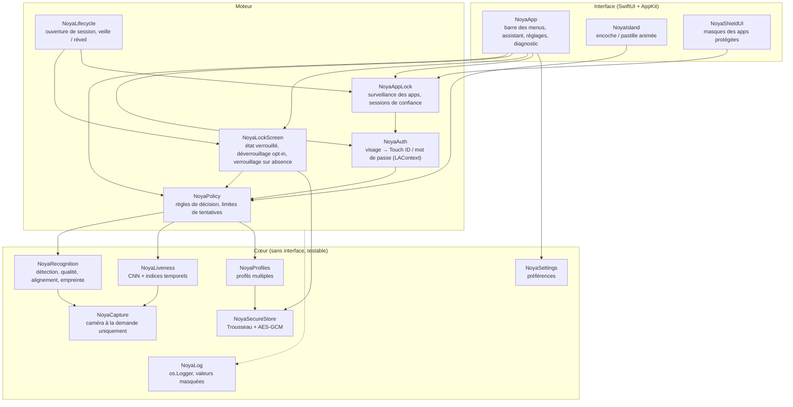
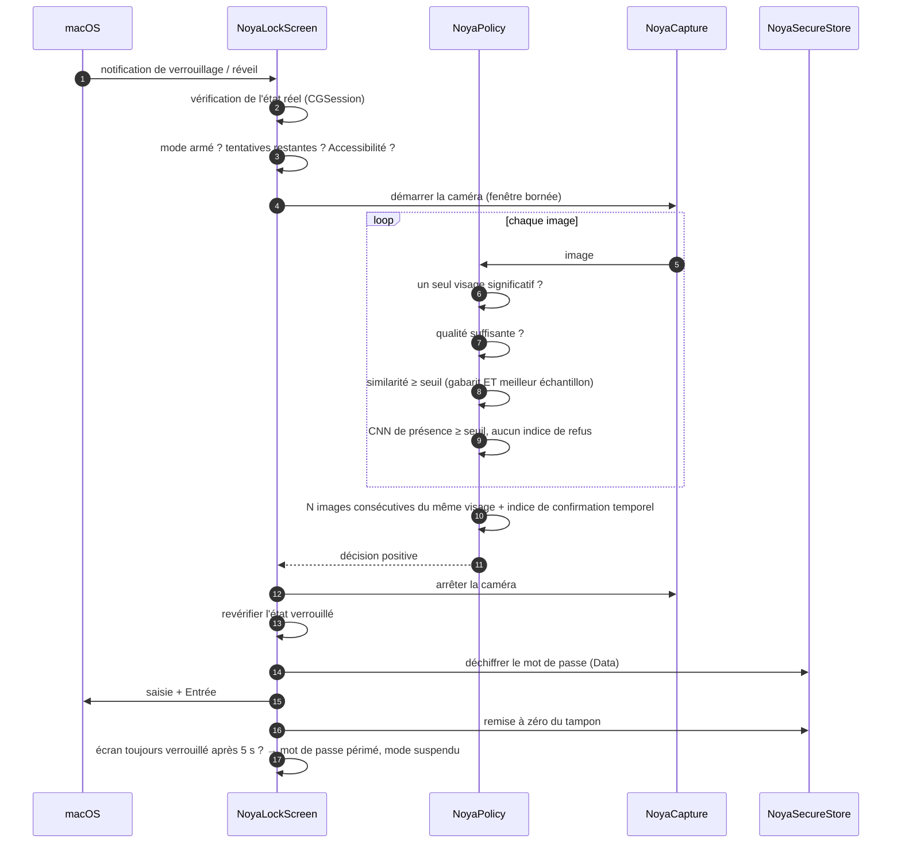

# Audit technique — NOYA Face

> Phase 1 (audit) et phase 2 (architecture) — document de décision, **aucun code applicatif n'a encore été écrit**.
>
> - Date : 16 novembre 2026
> - Dépôts analysés (clonés en lecture seule) :
>   - [iharshitmaurya/HeyMac](https://github.com/iharshitmaurya/HeyMac) — commit `a73667d` (09/11/2026)
>   - [jonnyoo/glance](https://github.com/jonnyoo/glance) — commit `b97f521` (29/09/2026)
>   - [HasBrain/FaceUnlock](https://github.com/HasBrain/FaceUnlock) — commit `d1a62e5` (19/07/2026)
> - Méthode : lecture du code source. Les références `fichier:ligne` renvoient au commit indiqué.
> - **Limites de cet audit** : l'environnement d'analyse est Linux, sans Xcode ni Mac. **Rien n'a été compilé, exécuté ni mesuré.** Aucun chiffre de performance ou de taux de reconnaissance n'est donné : ils devront être mesurés sur le MacBook Air M5 (jalons J4 à J11).

---

## 0. Synthèse

| Question | Réponse |
|---|---|
| Meilleure base | **HeyMac** (architecture modulaire, 110 tests, protection d'applications, licence MIT, maintenu activement) |
| À porter depuis Glance | Détection de présence réelle multi-indices temporels, profils faciaux multiples, clé de session protégée par Touch ID au niveau du Trousseau, détection du verrouillage par événements (sans scrutation) |
| À reprendre de FaceUnlock | **Aucun code.** Uniquement trois idées : rejet des images de préchauffage caméra, filtre de pose, moyenne glissante des empreintes |
| Bloquant n° 1 | **Licence du modèle de reconnaissance** : les trois projets embarquent un modèle ArcFace d'InsightFace, licencié « recherche non commerciale uniquement » ; depuis le 24/11/2025 InsightFace demande de le contacter pour toute licence des paquets `buffalo_*`. Incompatible avec une redistribution MIT sans réserve. |
| Bloquant n° 2 | **Il n'existe aucune API publique permettant à une application tierce de déverrouiller la session macOS.** Les trois projets **tapent le mot de passe stocké** dans l'écran de verrouillage par frappes simulées. Ce n'est pas une authentification ; c'est une saisie automatique. |
| Bloquant n° 3 | **Compte Apple Developer (99 $/an)** nécessaire pour : notarisation, identité de signature stable (sinon les autorisations Caméra/Accessibilité sont perdues à chaque mise à jour), et très probablement pour le Trousseau à protection biométrique (à confirmer, voir §3). |
| Sécurité réelle | Une webcam 2D ne vaut pas Face ID. Aucun des trois projets ne résiste de façon démontrée à une **vidéo rejouée**. Glance l'écrit explicitement (`FaceUnlockCoordinator.swift:7`). |

---

## 1. Tableau comparatif technique

| Critère | HeyMac | Glance | FaceUnlock |
|---|---|---|---|
| Activité | 130 commits, 12/09 → 09/11/2026 | 133 commits, 21/07 → 29/09/2026 | 23 commits, 05/07 → 19/07/2026 |
| Licence du code | MIT | MIT | MIT |
| Contributions externes | Acceptées (PR numérotées) | « Not currently accepting PRs » (README) | Non précisé |
| Structure | Swift Package, 3 modules : `HeyMacCore` (reconnaissance, crypto), `HeyMacEngine` (moteur), `HeyMacApp` (UI) | Projet Xcode, une seule cible, 1 dossier plat | Projet Xcode, une cible ; `ContentView.swift` 1 250 lignes, `AppController.swift` 822 lignes |
| Volume Swift (sources) | ~7 300 lignes | ~14 100 lignes | ~4 000 lignes |
| macOS minimum (README) | 14 | 15 | 14 |
| Tests automatisés | **~110 tests** (Core, Engine, App), images de référence sous Apache-2.0 | **0** test unitaire (un auto-test en ligne de commande `tools/liveness_selftest.swift`) | Pas de cible de test |
| Détection de visage | Vision `VNDetectFaceLandmarksRequest` | Vision rectangles + landmarks + qualité de capture | Vision |
| Modèle d'identité | ArcFace `w600k_mbf` (MobileFaceNet, 6,8 Mo) — **mêmes poids que Glance** (SHA-256 identique) | ArcFace `w600k_mbf` (6,8 Mo), repli `VNGenerateImageFeaturePrint` | ArcFace `w600k_r50` (ResNet50, 87 Mo) |
| Licence des poids | InsightFace : non commercial | InsightFace : non commercial | InsightFace : non commercial (déclaré dans le README) |
| Profils faciaux | 1 seul (centroïde unique) | Plusieurs identités, activables séparément | 1 jeu d'empreintes (max 35) |
| Images stockées | Non (centroïde chiffré) | Non (empreintes chiffrées) | Non (empreintes chiffrées) |
| Présence réelle | Réseau MiniFASNetV2 (Silent-Face-Anti-Spoofing, Apache-2.0), image par image, 2 images consécutives | 5 indices sur ~2 s : reflets, cadre d'appareil (refus) ; parallaxe nez/lacet, géométrie 3D, clignement (confirmation). **Mode « Léger » par défaut = refus seulement** | Variation de lacet ou de roulis > 0,013 rad (≈ 0,75°) sur 6 images |
| Plusieurs personnes | Choisit le plus grand visage | Choisit le visage dominant / continuité | Choisit un visage centré |
| Seuil de similarité par défaut | 0,50 (0,45 « Relaxed », 0,60 « Strict ») | 0,66 | 0,70 |
| Stockage du mot de passe | Fichier AES-GCM ; clé dans le trousseau de session **sans contrôle d'accès** | Trousseau, AES-GCM ; clé de session protégée `.userPresence` (Touch ID/mot de passe) | Trousseau, AES-GCM ; clé **sans contrôle d'accès**, Touch ID vérifié seulement par l'application |
| Durée de vie de la clé en mémoire | Toute la vie du processus | Jusqu'à 30 jours par défaut (7 j minimum) | Toute la vie du processus |
| Déverrouillage | Frappes simulées `CGEvent` (`.cghidEventTap`) + Accessibilité | Idem + effacement préalable du champ | Idem |
| Détection du verrouillage | Scrutation toutes les 250 ms + `dlopen` à chaque tour | Notifications + vérification `CGSessionCopyCurrentDictionary` | Notifications + vérification `CGSessionCopyCurrentDictionary` |
| Affichage sur l'écran verrouillé | **API privées SkyLight** | **API privées SkyLight** | Aucun |
| Protection d'applications | **Oui** (bouclier, Touch ID/mot de passe système, politiques de reverrouillage) | Non | Non |
| Verrouillage automatique en cas d'absence | Non | Non | Non |
| Localisation | Fondation en place (anglais) | Chaînes en dur (anglais) | Chaînes en dur (anglais) |
| Anti-débogage | Non | Non | `ptrace(PT_DENY_ATTACH)` via `dlsym` |

Les sections *Build, signature et distribution* et *Interface* sont complétées en §7 et §8.

---

## 2. Analyse du module le plus sensible : le déverrouillage

### 2.1 Ce que font réellement les trois projets

Les trois projets suivent le même schéma : le mot de passe de session est stocké chiffré, puis, quand un visage correspond, il est **tapé** dans le champ de l'écran de verrouillage par des événements clavier synthétiques.

- HeyMac : `Sources/HeyMacEngine/KeystrokeInjector.swift:255-286` — un événement Unicode par caractère, posté sur `.cghidEventTap`, puis Entrée.
- Glance : `glance/KeystrokeInjector.swift:42-161` — efface d'abord le champ (⌘→ puis ⌘⌫), envoie le texte par lots de 20 unités UTF-16 sans couper les paires de substitution, puis Entrée.
- FaceUnlock : `FaceUnlock/Security/KeystrokeInjector.swift:46-89` — un événement par caractère.

Conséquences :

1. **Ce n'est pas une authentification.** macOS reçoit le vrai mot de passe ; la reconnaissance faciale ne fait que décider s'il faut le taper. La sécurité globale est donc *au mieux* celle du mot de passe, et *en pratique* celle du maillon le plus faible entre la reconnaissance faciale et le stockage du mot de passe.
2. **Comportement non garanti par Apple.** L'API `CGEvent` est publique, mais son acheminement jusqu'au champ sécurisé de l'écran de verrouillage n'est pas documenté. Une mise à jour de macOS peut le bloquer sans préavis.
3. **Accessibilité obligatoire** : c'est une permission très large (contrôle de toute l'interface).

### 2.2 Stockage du mot de passe — comparaison détaillée

**HeyMac**
- Clé AES-256 stockée comme mot de passe générique dans le trousseau de session, sans `kSecAttrAccessControl` ni `kSecAttrAccessible` (`Sources/HeyMacCore/Security/KeychainKeyProvider.swift:68-77`). Seule la liste de contrôle d'accès par application du trousseau historique la protège.
- La clé est mise en cache pour toute la durée du processus (`CachingKeyProvider.swift:24-31`).
- Fichiers chiffrés AES-GCM écrits en `0600` par renommage atomique, dossier en `0700` (`SecureStore.swift:139-169`) — **bonne pratique, réutilisable**.
- **Défaut** : le mot de passe est déchiffré **avant** la reconnaissance faciale et conservé dans une `String` Swift (non effaçable) pendant toute la fenêtre de scan de 6 s (`LockScreenUnlocker.swift:141-153`).
- **Qualité** : si l'écran reste verrouillé 5 s après la saisie, le mot de passe est considéré comme périmé et la saisie automatique est désactivée (`LockScreenUnlocker.swift:185-196`) — évite de verrouiller le compte par tentatives répétées.

**Glance**
- Deux niveaux : une clé de session protégée par `SecAccessControl` `.userPresence` + `WhenUnlockedThisDeviceOnly` (`KeychainManager.swift:338-350`), qui chiffre un blob de mot de passe stocké sans protection biométrique (`SecureCredentialManager.swift:5-6, 171-186`).
- Touch ID est demandé une fois, puis la clé reste en mémoire jusqu'à un délai d'inactivité : **30 jours par défaut**, choix 7/14/30 jours ou jamais (`Settings/GlanceSettings.swift:13-34, 340-342`, `SessionAutoLocker.swift:16-17`).
- Le mot de passe est manipulé en `Data` et remis à zéro après usage (`POCController.swift:112-116`) ; une conversion en `String` reste nécessaire juste avant la saisie (`KeystrokeInjector.swift:46`).
- Refuse de créer une nouvelle clé si des données chiffrées existent déjà (`SecureCredentialManager.swift:138-142`) — **bonne pratique**.
- Entitlement `keychain-access-groups` avec `$(AppIdentifierPrefix)` (`glance/glance.entitlements`) : suppose une signature avec un identifiant d'équipe Apple.

**FaceUnlock**
- La protection `.userPresence` a été **retirée** « pour compatibilité avec la signature ad hoc » (`Security/PasswordVault.swift:5-13`). La clé de session et le blob chiffré sont tous deux dans le trousseau **sans contrôle d'accès** (`PasswordVault.swift:324-330, 345-351`).
- Touch ID est vérifié par l'application (`LAContext.evaluatePolicy`) avant une lecture qui, elle, n'exige rien (`PasswordVault.swift:210-254`). **La « protection Touch ID » annoncée par le README n'est pas appliquée par le système** : tout code capable de lire ces éléments du trousseau obtient la clé et le mot de passe.
- Politique `.deviceOwnerAuthenticationWithBiometrics` (`PasswordVault.swift:217`) : échoue sur un Mac sans Touch ID, contrairement au README qui annonce « Touch ID or a device password ».
- Attente bloquante sur sémaphore autour de `evaluatePolicy` (`PasswordVault.swift:221-227`), motif que Glance documente comme source d'interblocage (`SecureCredentialManager.swift:121-122`).

> Enseignement clé (à confirmer sur Mac) : la protection biométrique d'un élément du trousseau semble exiger le **trousseau à protection des données** et donc une signature avec identifiant d'équipe. Indice concret : FaceUnlock a dû la retirer en signature ad hoc ; Glance la conserve avec un entitlement d'équipe. La note technique Apple TN3137 traite de ce sujet ; elle n'a pas pu être relue ici et devra être vérifiée.

### 2.3 Détection fiable de l'état « verrouillé »

- Notifications distribuées `com.apple.screenIsLocked` / `screenIsUnlocked` : non documentées et **falsifiables par tout processus de l'utilisateur** (Glance le note : `LockMonitor.swift:187-188`).
- `CGSessionCopyCurrentDictionary()` : Glance et FaceUnlock l'appellent directement (`LockMonitor.swift:289`, `FaceUnlock/Security/LockMonitor.swift:162`), ce qui montre que la fonction est déclarée dans le SDK. **La clé `CGSSessionScreenIsLocked` lue dans le dictionnaire n'est pas documentée.** HeyMac la résout par `dlopen`/`dlsym` en la qualifiant de privée (`LockStateMonitor.swift:3-33`), et ce, **à chaque tour de boucle de 250 ms** (`LockScreenUnlocker.swift:105-109, 122`).
- Les trois revérifient l'état juste avant la saisie. HeyMac le fait avant **et** après le réveil de l'écran (`ScreensaverWatcher.swift:64-86`) — à conserver.

### 2.4 Ce que macOS permet, officiellement ou non

| Besoin | Mécanisme | Statut |
|---|---|---|
| Déverrouiller une session ouverte (écran de verrouillage, réveil de veille) | Saisie simulée du mot de passe via `CGEvent` + Accessibilité | **Contournement** : API publique utilisée hors de son objet, comportement non documenté |
| Idem, sans stocker le mot de passe | *Authorization Plugin* (Authorization Services, `/Library/Security/SecurityAgentPlugins`) | Mécanisme documenté par Apple, utilisé par des outils d'entreprise. Exige une installation **root**, la modification de la base d'autorisations et comporte un **risque de blocage de session**. **Non vérifié** pour le déverrouillage sans mot de passe sur macOS 26 → piste de recherche, prototype en machine virtuelle uniquement, **hors v1** |
| Écran de connexion après redémarrage | — | **Impossible** : le trousseau de session exige le mot de passe. Même comportement que Touch ID sur Mac |
| Déverrouillage FileVault au démarrage | — | **Impossible** : aucun code tiers ne s'exécute avant l'authentification FileVault |
| Changement rapide d'utilisateur | — | **Non pris en charge** : mot de passe obligatoire |
| Touch ID / mot de passe dans l'application | `LAContext.evaluatePolicy(.deviceOwnerAuthentication)` | **Officiel** — utilisable pour la protection d'applications et pour « armer » la session, pas pour l'écran de verrouillage |
| Vérifier que le mot de passe saisi par l'utilisateur est correct avant de le stocker | OpenDirectory `ODRecord.verifyPassword` | API publique (aucun des trois ne l'utilise) — **à valider** sur Mac |
| Afficher une interface au-dessus de l'écran verrouillé | SkyLight `SLSSpaceCreate`, `SLSSpaceSetAbsoluteLevel`, `SLSShowSpaces`… via `dlopen` (HeyMac `Island/LockScreenSpace.swift:39-52`, Glance `NotchOverlay/NotchSkyLight.swift:34-51`) | **API privée** — peut casser à chaque mise à jour |
| Empêcher réellement l'ouverture d'une application | Endpoint Security (`AUTH_EXEC`) | Exige un entitlement accordé par Apple et une extension système : **hors de portée** d'un projet open source compilable par tous. Les trois projets n'en utilisent pas |
| Verrouiller le Mac en cas d'absence | Raccourci système ⌃⌘Q simulé (Accessibilité) ou mise en veille de l'écran si « Exiger le mot de passe immédiatement » | Aucun des trois ne l'implémente — **à valider** sur Mac |

---

## 3. Reconnaissance faciale et présence réelle

### 3.1 Reconnaissance

- **HeyMac** : alignement 5 points sur le gabarit ArcFace avec un échantillonneur bilinéaire équivalent à OpenCV (`FaceGeometry.swift`), empreinte normalisée, comparaison cosinus avec **un seul centroïde** (`VerificationPipeline.swift:189-221`). Deux images consécutives acceptées exigées, arrêt après 6 images « mauvais visage » (`FaceVerifier.swift:90-122`). Seuils 0,45/0,50/0,60 (`EngineSettings.swift:6-11`) — nettement plus permissifs que Glance (0,66) **pour le même modèle** : à calibrer par mesure.
- **Glance** : plusieurs identités, chacune avec ses échantillons et un gabarit ; un visage doit dépasser le seuil sur le gabarit **et** sur le meilleur échantillon (`FaceRecognitionPipeline.swift:126-147`) ; identités marquées « périmées » si l'extracteur change. Repli silencieux vers `VNGenerateImageFeaturePrint` si ArcFace ne se charge pas (`FaceRecognitionPipeline.swift:44-52`) — à proscrire dans NOYA Face (échec franc préférable).
- **FaceUnlock** : moyenne glissante de 15 empreintes, rejet des images des 800 premières ms (exposition caméra non stabilisée), filtre de pose (`AppController.swift:686-800`). Idées intéressantes ; modèle ResNet50 13 fois plus lourd.

**Plusieurs personnes dans le champ** : aucun des trois ne refuse. HeyMac prend le plus grand visage (`FaceGeometry.swift:198`), Glance le visage dominant (`FaceRecognitionPipeline.swift:99-112`). Pour un déverrouillage, NOYA Face devra **refuser** lorsqu'un second visage significatif est présent (réglable pour la protection d'applications).

### 3.2 Présence réelle (anti-usurpation)

| Attaque | HeyMac (CNN image par image) | Glance mode Léger (défaut) | Glance mode Lourd | FaceUnlock (mouvement) |
|---|---|---|---|---|
| Photo imprimée | Dépend du modèle (non mesuré) | **Non bloquée** si ni reflet ni cadre détecté : « confirmé sauf preuve contraire » (`LivenessCues.swift:71, 256-257`) | Bloquée selon le README | Probablement **non bloquée** si tenue à la main (le moindre roulis > 0,75° suffit) — non testé |
| Photo sur téléphone | Dépend du modèle | Indices reflet + cadre | Idem + confirmation | Idem photo |
| Vidéo sur écran | Non garanti | Non | **Non** (aveu du code : `FaceUnlockCoordinator.swift:7`) | Non |
| Tentatives répétées | 2 scans par épisode de verrouillage | 1 relance automatique (option) | Idem | Non limité explicitement |

**Conclusion** : aucune approche n'est suffisante seule. Le réseau MiniFASNet de HeyMac analyse la *texture* d'une image ; les indices de Glance analysent la *géométrie et le mouvement* dans le temps. Ils sont complémentaires, mais **leur combinaison ne sera retenue qu'après un protocole de test mesuré** (jalon J6) : sans mesure, on ne peut pas affirmer qu'elle améliore la sécurité.

---

## 4. Failles et limites à corriger en priorité

| # | Gravité | Projet | Problème | Référence | Correction prévue dans NOYA Face |
|---|---|---|---|---|---|
| 1 | Critique | Tous | Modèle ArcFace InsightFace sous licence non commerciale, redistribué dans un projet MIT | README FaceUnlock §License ; `glance/tools/convert_arcface.py:35-40` ; `HeyMac/THIRD_PARTY_NOTICES.md` | Évaluer un modèle à licence permissive (ex. SFace d'OpenCV Zoo, Apache-2.0 — jeu d'entraînement non documenté, à vérifier) ou obtenir une licence écrite ; ne publier aucune version avant décision |
| 2 | Critique | FaceUnlock | « Protection Touch ID » appliquée par l'application seulement ; clé et mot de passe chiffré lisibles sans authentification | `PasswordVault.swift:5-13, 210-254, 324-351` | Contrôle d'accès appliqué par le trousseau (`.userPresence`) ou mode désactivé |
| 3 | Élevée | Glance | Présence réelle « Léger » par défaut : n'exige aucune preuve de visage réel | `GlanceSettings.swift:292-296` ; `LivenessCues.swift:256-257` | Mode strict obligatoire pour le déverrouillage de l'écran |
| 4 | Élevée | HeyMac | Clé de chiffrement sans contrôle d'accès, en mémoire toute la vie du processus | `KeychainKeyProvider.swift:68-77` ; `CachingKeyProvider.swift` | Clé protégée `.userPresence`, durée d'armement courte et configurable |
| 5 | Élevée | HeyMac | Mot de passe déchiffré avant la reconnaissance et conservé en `String` | `LockScreenUnlocker.swift:141-153` | Déchiffrement uniquement après décision positive, en `Data` remis à zéro |
| 6 | Élevée | Glance | Clé de session en mémoire jusqu'à 30 jours par défaut | `GlanceSettings.swift:340-342` | Défaut 24 h, maximum 7 jours, réarmement après redémarrage et après N échecs |
| 7 | Élevée | Tous | Aucun refus quand plusieurs visages sont présents | voir §3.1 | Refus si un second visage significatif est détecté |
| 8 | Élevée | Tous | Vidéo rejouée non bloquée | voir §3.2 | Avertissement explicite + mode « déverrouillage de l'écran » désactivé par défaut |
| 9 | Moyenne | HeyMac, Glance | API privées SkyLight pour l'affichage sur l'écran verrouillé | §2.4 | Module isolé, optionnel, dégradation propre si indisponible (décision à valider) |
| 10 | Moyenne | FaceUnlock | `PT_DENY_ATTACH` via `dlsym` ; README demandant `xattr -dr com.apple.quarantine` (contournement de Gatekeeper) | `AppController.swift:252-260` ; README | Aucun anti-débogage ; aucune instruction de contournement |
| 11 | Moyenne | HeyMac | Boucle de scrutation permanente toutes les 250 ms + `dlopen` à chaque tour | `LockScreenUnlocker.swift:105-109` ; `LockStateMonitor.swift:16-19` | Détection par événements (modèle Glance) + vérification ponctuelle |
| 12 | Moyenne | Glance | Repli silencieux vers un extracteur générique moins discriminant | `FaceRecognitionPipeline.swift:44-52` | Échec explicite, diagnostic |
| 13 | Moyenne | Glance, FaceUnlock | Pas de tests ; classes géantes (FaceUnlock) | §1 | Tests unitaires obligatoires par module |
| 14 | Faible | Glance | Fichier chiffré écrit avec le masque de permissions par défaut | `SecureFaceStore.swift:48` | Écriture `0600` atomique (modèle HeyMac) |

---

## 5. Réutilisable immédiatement (avec attribution)

| Origine | Élément | Fichiers | État |
|---|---|---|---|
| HeyMac | Découpage en modules et injection de dépendances (`LockScreenEnvironment`) | `Package.swift`, `HeyMacEngine/*` | Reprendre tel quel, renommer |
| HeyMac | Stockage chiffré atomique `0600` | `HeyMacCore/Security/SecureStore.swift` | Reprendre |
| HeyMac | Alignement ArcFace + échantillonneur équivalent OpenCV | `HeyMacCore/Recognition/FaceGeometry.swift` | Reprendre |
| HeyMac | Enrôlement avec zone de préparation (un échec n'écrase pas le profil actif) | `HeyMacEngine/Enroller.swift`, `HeyMacRuntime.swift:63-118` | Reprendre, étendre au multi-profil |
| HeyMac | Classifieur anti-usurpation MiniFASNet + tests de non-régression | `HeyMacCore/Recognition/AntiSpoofClassifier.swift`, `Tests/HeyMacCoreTests/Fixtures` | Reprendre, mesurer |
| HeyMac | Coordinateur d'authentification visage → Touch ID/mot de passe système | `HeyMacEngine/AppLock/AuthCoordinator.swift`, `LocalSystemAuth.swift` | Reprendre |
| HeyMac | Sessions de confiance sur horloge monotone (insensible au changement d'heure) | `HeyMacEngine/AppLock/SessionBook.swift` | Reprendre |
| HeyMac | Liste d'applications non verrouillables (Terminal, Réglages, Moniteur d'activité…) | `HeyMacEngine/AppLock/AppLockBlacklist.swift` | Reprendre |
| HeyMac | Double vérification de l'état verrouillé et détection du mot de passe périmé | `ScreensaverWatcher.swift`, `LockScreenUnlocker.swift:185-196` | Reprendre |
| Glance | Indices de présence réelle temporels + auto-test | `glance/Liveness/*`, `tools/liveness_selftest.swift` | Porter dans un module dédié, ajouter des tests |
| Glance | Modèle multi-identités (échantillons + gabarit + détection d'extracteur périmé) | `FaceEnrollmentStore.swift`, `FaceRecognitionPipeline.swift:126-147` | Porter |
| Glance | Stockage à deux niveaux avec clé `.userPresence` | `SecureCredentialManager.swift`, `KeychainManager.swift` | Porter, durcir (durées, effacement) |
| Glance | Surveillance du verrouillage par événements | `LockMonitor.swift` | Porter |
| Glance | Saisie robuste (effacement du champ, lots Unicode sûrs) | `KeystrokeInjector.swift` | Porter |
| FaceUnlock | Rejet du préchauffage, filtre de pose, moyenne glissante | `AppController.swift:686-800` | **Idées seulement**, réimplémentées et testées |

Les vidéos d'animation (`unlockanimation.mp4`…) proviennent de Glance et sont reprises par HeyMac : elles constituent l'identité visuelle d'un autre produit. **NOYA Face créera ses propres animations en SwiftUI.**

---

## 6. Architecture proposée pour NOYA Face

### 6.1 Principe : deux modes clairement séparés

| Mode | Activé par défaut | Mot de passe stocké | Permissions | Fonctions |
|---|---|---|---|---|
| **Protection** | Oui | **Non** | Caméra (+ Accessibilité si verrouillage automatique par raccourci) | Protection d'applications (visage, repli Touch ID / mot de passe vérifié par macOS), verrouillage automatique en cas d'absence, interface de l'encoche |
| **Déverrouillage de l'écran** (avancé) | Non, activation explicite après avertissement | Oui, chiffré, clé protégée par Touch ID / mot de passe au niveau du trousseau | Caméra + Accessibilité | Session déjà ouverte : écran de verrouillage et réveil de veille. **Jamais** après redémarrage, FileVault ou changement d'utilisateur |

### 6.2 Modules

Localisation : catalogue de chaînes Apple (`.xcstrings`) dans chaque module comportant du texte visible, français de France en langue de développement, anglais en seconde langue.

### 6.3 Règle de décision d'un déverrouillage de l'écran

Règles supplémentaires :
- au plus 2 scans par épisode de verrouillage, puis mot de passe manuel ;
- après K épisodes en échec, désarmement et Touch ID obligatoire pour réarmer ;
- armement : Touch ID / mot de passe ; durée par défaut 24 h, maximum 7 jours, désarmement au redémarrage ;
- caméra : jamais en continu ; uniquement pendant une fenêtre bornée déclenchée par un événement.

### 6.4 Verrouillage automatique en cas d'absence (nouveau)

Aucun des trois projets ne le propose. Conception économe : la caméra n'est **jamais** allumée tant que l'utilisateur tape ou bouge la souris. Après X secondes sans activité (temps d'inactivité système), une vérification courte (≈ 1 s) est faite toutes les Y secondes ; après Z vérifications sans visage reconnu, le Mac est verrouillé. Le voyant de la caméra s'allumera à chaque vérification : ce sera affiché clairement dans les réglages.

### 6.5 Où sont stockées les données

| Donnée | Emplacement | Protection |
|---|---|---|
| Profils faciaux (empreintes numériques, aucune image) | `~/Library/Application Support/NOYA Face/` (dossier `0700`, fichiers `0600`) | AES-256-GCM, clé dans le trousseau |
| Clé de chiffrement des profils | Trousseau, `ThisDeviceOnly` | Liée à l'appareil |
| Mot de passe de session (mode avancé uniquement) | Trousseau | AES-256-GCM, clé protégée `.userPresence` |
| Réglages | `UserDefaults` | Non sensibles |
| Journaux | Journal unifié macOS (`os.Logger`) | Valeurs dynamiques marquées privées ; jamais de mot de passe, d'image ni d'empreinte |

---

## 7. Build, signature et distribution

*(complété à partir de l'analyse des scripts et projets — voir ci-dessous)*

---

## 8. Interface, encoche et protection d'applications

*(complété à partir de l'analyse de la couche interface — voir ci-dessous)*

---

## 9. Plan de développement

*(voir ci-dessous)*
